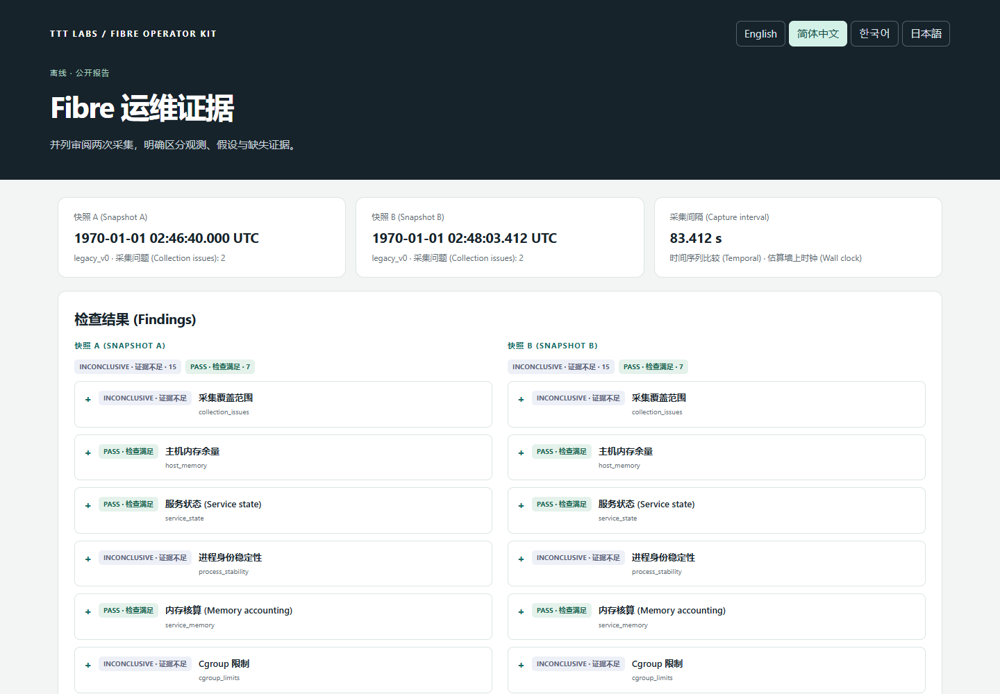
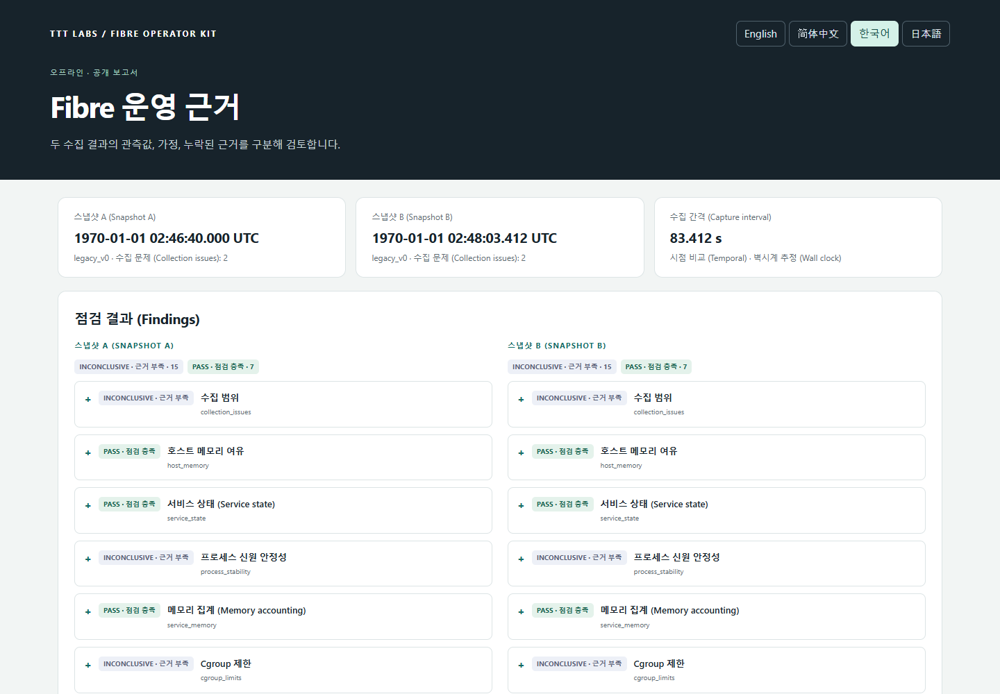
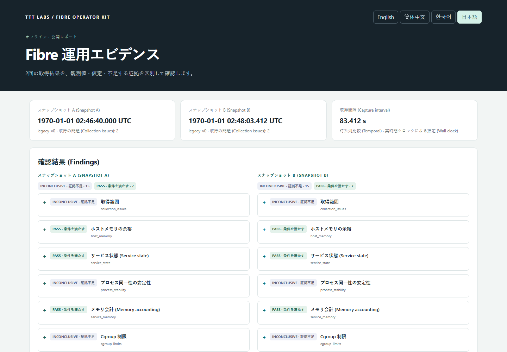

# TTT Fibre Operator Kit

<a id="languages"></a>

[English](#en) | [简体中文](#zh-cn) | [한국어](#ko) | [日本語](#ja)

<a id="en"></a>

## English

### Overview

TTT Fibre Operator Kit is a read-only CLI for Celestia Fibre operators. It collects bounded observations on a Linux host, analyzes snapshots offline, models receive-buffer capacity and compares captures in a standalone HTML report.

Version 0.1 has a terminal interface and an interactive **report viewer**. The HTML can switch languages and expand findings; it cannot start collection, connect to SSH or change configuration. There is no desktop control panel or background dashboard.

| Capability | Windows x86_64 | Linux x86_64 |
| --- | --- | --- |
| Analyze snapshots; model capacity; generate HTML/JSON | Yes | Yes |
| Offline fixture collection with `--sysroot` | Yes | Yes |
| Live process, systemd, cgroup and storage collection | No | Yes |

Live collection targets systemd services and cgroup v2. Default services are `celestia-appd.service` and `fibre.service`. The initial Fibre capacity/storage profile is `v10.4.0-mocha`; unknown versions are not silently treated as supported. Unreadable sections remain missing or inconclusive.

The kit does not restart services, inject traffic, upload blobs, edit configuration or delete storage. Load benchmarks, recovery tests, automatic tuning and S3/R2 integration are outside v0.1.

### Report preview


This report was generated from the bundled [synthetic fixtures](tests/fixtures/legacy/), not measurements from a live validator. The HTML viewer supports all four languages.


The 16/24/32 connection values are receive-buffer model scenarios, not measured RAM consumption.

[Full report screenshot (English)](docs/screenshots/report-full-en.png) · [Capacity detail (English)](docs/screenshots/report-capacity-en.png) · [Offline HTML report](docs/examples/report.html) · [Public JSON report](docs/examples/report.json)

Download the HTML file and open it locally in your browser; GitHub displays its source rather than running the report viewer.

### Installation

Cloning this repository gives you source code; prebuilt binaries are not stored in Git. Build from source as described below, or obtain a trusted binary bundle containing `SHA256SUMS` separately. The bundle commands in this section assume you have already obtained and extracted that bundle.

**Linux:** confirm that `uname -m` reports `x86_64`, verify the bundle, and run its musl executable. The commands below run from the extracted release directory; no system-wide installation is required.

```sh
uname -m
sha256sum -c SHA256SUMS
chmod +x ./ttt-fibre-linux-x86_64-musl
./ttt-fibre-linux-x86_64-musl --version
./ttt-fibre-linux-x86_64-musl collect --out snapshot.json
```

The Linux artifact is a static binary. Python, Rust and Docker are not required on the validator. Live reads use systemd and `ss` where available; missing commands or permissions reduce collection coverage. Run under an account that already has the required read permissions.

**Windows PowerShell:** compare the executable's SHA256 with its entry in `SHA256SUMS`, then run offline analysis.

```powershell
Get-FileHash .\ttt-fibre-windows-x86_64.exe -Algorithm SHA256
.\ttt-fibre-windows-x86_64.exe --version
.\ttt-fibre-windows-x86_64.exe doctor --snapshot .\snapshot.json
```

In subsequent examples, `ttt-fibre` means the executable on your PATH. Otherwise substitute `./ttt-fibre-linux-x86_64-musl`, `./target/release/ttt-fibre`, or the corresponding Windows `.exe` path. Shell blocks marked `sh` use POSIX syntax; keep commands on one line when adapting them to PowerShell.

### Try it without a server

From the source checkout, generate a report from the bundled **synthetic** snapshots. These fixtures contain no validator data.

```sh
cargo run --locked -- doctor --snapshot tests/fixtures/legacy/snapshot-a.json
cargo run --locked -- capacity --snapshot tests/fixtures/legacy/snapshot-a.json --profile v10.4.0-mocha --target-connections 24
cargo run --locked -- report compare tests/fixtures/legacy/snapshot-a.json tests/fixtures/legacy/snapshot-b.json --mode temporal --allow-legacy-identity --profile v10.4.0-mocha --out example.html
```

Open `example.html` in a browser. `example.json` is the accompanying public report. No web server or internet connection is needed. Choose a new filename on subsequent runs: output files are not overwritten.

### CLI reference

| Command | Purpose |
| --- | --- |
| `collect --out snapshot.json` | Write one private operational snapshot; Linux live mode by default |
| `collect --stdout` | Emit the same snapshot to stdout; choose exactly one output destination |
| `doctor --snapshot snapshot.json` | Show findings, evidence, impact and verification steps |
| `doctor --snapshot - --json` | Read one snapshot from stdin and return public findings as JSON |
| `capacity --snapshot snapshot.json --target-connections 24` | Calculate a configuration scenario without applying it |
| `report compare A.json B.json --out report.html` | Write offline HTML and a public `report.json` sidecar |

Global `--lang en|zh-CN|ko|ja` selects CLI text and the report's initial language; English is the default. Every HTML report embeds all four languages. JSON keys, metric names, flags and check IDs remain unchanged. `doctor` and `capacity` support `--json`.

`--profile v10.4.0-mocha` is an explicit model assumption, not an observed binary version. Use it only when that assumption is justified. Results go to stdout and diagnostic messages to stderr. Exit code `0` means the command completed, **not** that every check passed; command/input errors return `2`. Automation should inspect finding statuses and collection issues.

### Collection and metrics

Override service names and homes when they differ from the defaults:

```sh
ttt-fibre collect --out snapshot-custom.json --app-unit celestia-appd.service --fibre-unit fibre.service --app-home /srv/celestia --fibre-home /srv/fibre
ttt-fibre collect --out snapshot-file.json --fibre-metrics-file metrics.prom
ttt-fibre collect --out snapshot-http.json --fibre-metrics-url http://127.0.0.1:8889/metrics
ttt-fibre collect --out snapshot-otel.json --otel-config /etc/otelcol/config.yaml
```

Paths and port `8889` above are examples, not discovered defaults. Supply your existing configuration. Explicit metrics URLs must use HTTP with a numeric loopback address and port; credentials, redirects and remote addresses are rejected. `--fibre-prom-url` is an alias for `--fibre-metrics-url`.

Metrics-file input takes precedence over URL/discovery and does not verify target identity or freshness. OTel discovery requires an identifiable local Fibre OTLP receiver, collector process/configuration and matching enabled Prometheus exporter pipeline. `--otel-config` helps validate that relationship; it does not turn any YAML file into a trusted endpoint. Ports are not guessed, and OTLP ingestion endpoints are not scraped as Prometheus endpoints.

`--no-fd-inspection` disables the additional inode-based matching between aged staging files and open descriptors; FD counts are still collected. `--sysroot PATH` instead selects offline fixtures and disables live commands/network. See [schema conventions](docs/schema.md) for field meanings.

### Capacity and comparison

For the supported profile:

```text
receive_buffer_bytes = max_connections × max_concurrent_streams × 132 MiB
```

With 13 concurrent streams, the model yields:

| Connections | Receive-buffer model |
| --- | --- |
| 16 | 26.8125 GiB |
| 24 | 40.21875 GiB |
| 32 | 53.625 GiB |

This is a concurrency model, not measured RAM, total process memory or a safe hardware recommendation. Increasing connections increases modeled buffers. RSS, anonymous memory, file cache and cgroup memory overlap; do not add them together. Account for other services, parent cgroup limits and FD headroom. `CONFIG_FILE` values are not proof that the running process loaded them; the other sources are `OBSERVED_RUNTIME`, `DEFAULT_ASSUMED` and `UNKNOWN`.

The default `--mode ab` compares independent environments side by side and never produces temporal counter rates. Use temporal mode for successive captures:

```sh
ttt-fibre report compare before.json after.json --mode temporal --out temporal.html
ttt-fibre report compare legacy-a.json legacy-b.json --mode temporal --allow-legacy-identity --out legacy.html
```

`Verified` requires complete process/host/boot identity evidence. `HeuristicLegacy` is an explicit same-host assumption for older snapshots, not verified continuity. `Mismatch` and `Unknown` withhold affected temporal calculations. Rates also require valid timing and appropriate process/cgroup/host scope; counter resets make rates unavailable. A short memory delta does not establish a leak or historical uptime.

### Reading findings and collection limits

| Status | Meaning |
| --- | --- |
| `PASS` | The individual check is satisfied by the available evidence |
| `WARN` | An observation needs investigation |
| `FAIL` | Evidence violates that check's condition |
| `INCONCLUSIVE` | Evidence is missing, incomplete, stale or insufficient |
| `UNSUPPORTED` | The version or observation cannot be evaluated by the supported model |

There is no overall readiness score. A collection error is not automatically a node failure. Signing requires the appropriate version, scoped samples and verified activity freshness; warm-up or a recent HTTP scrape alone does not establish healthy signing. Live v0.1 collection conservatively leaves freshness unverified.

| Collection bound | Limit |
| --- | --- |
| Overall collection work budget | 20 seconds, plus bounded cleanup/serialization overhead |
| Flat scan per `staging/` or `shards/` | 2 seconds / 50,000 entries |
| Kill/reap polling grace | 100 ms, nonblocking |
| Config read / metrics response / snapshot | 64 KiB / 1 MiB / 8 MiB |
| Aged staging threshold | More than 900 seconds |

Scans do not follow symlinks and deduplicate hardlinks. A partial result is **bytes observed**, not an instantaneous total or reliable lower bound during concurrent writes/pruning. `has_open_fd` is true, false or unknown; false requires complete scoped inspection and stable identity. Neither age nor a closed FD proves that a file is an orphan or safe to delete. A kernel-blocked worker can outlive a kill request; `cleanup_pending` exposes this.

Collector costs separate parent, collection worker and scanner CPU/RSS. Do not sum peak RSS values into a process-tree peak. Measurements end before final JSON serialization and SSH transfer. Reads still consume resources; review a first capture before repeated use.

### Privacy and SSH operation

Keep raw snapshots private. Public reports use an allowlisted projection that omits host/boot hashes, operational paths, PIDs, raw errors and arbitrary metric labels. This reduces disclosure but is not a blanket anonymity guarantee; review reports before publishing. Large integer measurements are decimal strings in public JSON to preserve browser precision.

Install through an administrative channel, then use a dedicated restricted collection key. An `authorized_keys` **template** is:

```text
restrict,expiry-time="YYYYMMDDHHMMSSZ",command="/usr/local/bin/ttt-fibre collect --stdout" ssh-ed25519 PUBLIC_KEY collector-only
```

Replace the date and public key, verify the host fingerprint, and protect binary ownership. The client command below assumes that the forced command is already configured; the word `snapshot` is not a remote subcommand installed by the kit.

```sh
ssh -n -T -o BatchMode=yes -o StrictHostKeyChecking=yes -o IdentitiesOnly=yes -o ForwardAgent=no -o ClearAllForwardings=yes -i /path/to/dedicated_key operator@host snapshot | ttt-fibre doctor --snapshot -
```

No private key is required in the repository. See [operations](docs/operations.md) for account permissions and fixed-command deployment.

### Build, tests and packaging

The manifest declares Rust 1.85; recorded builds used Rust 1.99.0. Use `Cargo.lock`. Windows MSVC builds require the C++ build tools and Windows SDK; Windows GNU builds need compatible MinGW tools. Building a static Linux target also needs that Rust target and a compatible linker.

```sh
cargo fmt --all -- --check
cargo test --locked
cargo clippy --locked --all-targets -- -D warnings
cargo build --locked --release
rustup target add x86_64-unknown-linux-musl
cargo build --locked --release --target x86_64-unknown-linux-musl
cp target/x86_64-unknown-linux-musl/release/ttt-fibre ./ttt-fibre-linux-x86_64-musl
./ttt-fibre-linux-x86_64-musl --version
```

Cargo names the Linux executable `ttt-fibre`; packaging gives it the filename `ttt-fibre-linux-x86_64-musl` used in the installation examples. The `cp` command above creates that filename in your checkout. Run these Linux build commands on a development or lab machine, then copy the finished binary to the validator. Windows users can use the cross-compilation helper below and run the resulting Linux binary on Linux.

Windows helpers support native builds and musl cross-compilation without WSL:

```powershell
powershell -NoProfile -ExecutionPolicy Bypass -File scripts/build-windows.ps1 -Release
powershell -NoProfile -ExecutionPolicy Bypass -File scripts/build-linux-from-windows.ps1 -Tests
powershell -NoProfile -ExecutionPolicy Bypass -File scripts/package.ps1
powershell -NoProfile -ExecutionPolicy Bypass -File scripts/package-source.ps1
```

The Linux helper compiles test executables; run them in a Linux lab to validate runtime behavior. Binary packaging requires both release targets and an unused output directory. Source packaging excludes local snapshots, SSH artifacts, build outputs and Git history. The build helpers do not install a missing Rust toolchain or compiler automatically.

Synthetic legacy fixtures are committed under `tests/fixtures/legacy/`. `--sysroot` fixtures use mirrored Linux files plus `run/ttt-fibre/<unit>.show`, `clock.json`, `staging.scan.json` and `shards.scan.json`; no live Unix metadata is inferred on Windows. `tests/linux_lab.py` is for a **disposable Alpine VM only**, never an operational node. `scripts/verify-report.py` uses Playwright to verify offline report interactions; Python is a development dependency only.

See the [validation record](docs/validation.md) for actual test counts and limitations. Lab checks do not establish production-validator compatibility. The supplied GitHub Actions workflow runs formatting, tests and lint/build checks when enabled in a repository; a workflow file is not evidence of a completed hosted run.

### Troubleshooting and project layout

| Symptom | Action |
| --- | --- |
| Live collection fails on Windows | Analyze a Linux snapshot or use explicit `--sysroot` fixtures |
| Output already exists | Choose a new filename; reports also reserve the `.json` sidecar |
| Unknown version / unavailable capacity | Verify the binary version and config; only explicitly assume the supported profile when justified |
| Empty metrics / inconclusive signing | Check the configured exporter, ownership, sample scope and freshness; do not guess ports |
| Partial scan / `cleanup_pending` | Inspect the stop reason and host I/O condition before retrying; do not delete data |
| Invalid stdin / expired probe output | Provide one supported JSON snapshot; an SSH or probe error is not a snapshot |

| Path | Contents |
| --- | --- |
| `src/model.rs`, `src/parser.rs` | Snapshot types and legacy conversion |
| `src/analyzer.rs` | Doctor, capacity and comparison logic |
| `src/collector/` | Bounded Linux collection and fixture readers |
| `src/report.rs`, `assets/` | Public projection and offline multilingual report |
| `tests/`, `scripts/` | Regression fixtures, lab/UI verification and packaging |
| `docs/` | Operations, schema and validation notes |

Contributions should include a reproducible case with synthetic or sanitized data and relevant tests. Do not submit raw operational snapshots, credentials or private keys. Licensed under [Apache-2.0](LICENSE).

[Back to language selection](#languages)

---

<a id="zh-cn"></a>

## 简体中文

### 概述

TTT Fibre Operator Kit 是面向 Celestia Fibre 节点运维人员的只读 CLI 工具。它在 Linux 主机上进行有界采集，离线分析快照，对接收缓冲区容量建模，并通过独立的 HTML 报告比较各次采集结果。

0.1 版提供终端界面和交互式**报告查看器**。HTML 报告可以切换语言并展开检查结果，但不能启动采集、建立 SSH 连接或更改配置。本工具不提供桌面控制面板或后台仪表板。

| 功能 | Windows x86_64 | Linux x86_64 |
| --- | --- | --- |
| 分析快照、容量建模、生成 HTML/JSON | 支持 | 支持 |
| 使用 `--sysroot` 采集离线测试数据 | 支持 | 支持 |
| 实时采集进程、systemd、cgroup 和存储数据 | 不支持 | 支持 |

实时采集面向 systemd 服务和 cgroup v2。默认服务为 `celestia-appd.service` 和 `fibre.service`。初始 Fibre 容量/存储模型配置为 `v10.4.0-mocha`；未知版本不会被默认为受支持版本。无法读取的部分会保留为缺失或无法确定的状态。

本工具不会重启服务、注入流量、上传 blob、编辑配置或删除存储数据。负载基准测试、恢复测试、自动调优和 S3/R2 集成不在 v0.1 的范围内。

### 报告预览



此报告由项目附带的[合成测试数据](tests/fixtures/legacy/)生成，并非来自正在运行的验证节点的实测数据。HTML 查看器支持全部四种语言。

[完整报告截图（英文）](docs/screenshots/report-full-en.png) · [容量详情（英文）](docs/screenshots/report-capacity-en.png) · [离线 HTML 报告](docs/examples/report.html) · [公开版 JSON 报告](docs/examples/report.json)

请下载 HTML 文件并在本地浏览器中打开；GitHub 会显示其源代码，不会运行报告查看器。

### 安装

克隆本仓库只会获得源代码；Git 中不包含预编译的二进制文件。请按照下文从源码构建，或另行获取包含 `SHA256SUMS` 的可信二进制包。本节中的发布包命令均假定你已获取并解压该包。

**Linux：**确认 `uname -m` 输出 `x86_64`，校验发布包，然后运行其中的 musl 可执行文件。以下命令在解压后的发布目录中执行，无需全局安装。

```sh
uname -m
sha256sum -c SHA256SUMS
chmod +x ./ttt-fibre-linux-x86_64-musl
./ttt-fibre-linux-x86_64-musl --version
./ttt-fibre-linux-x86_64-musl collect --out snapshot.json
```

Linux 构建产物是静态二进制文件。验证节点上无需安装 Python、Rust 或 Docker。实时读取会在可用时使用 systemd 和 `ss`；缺少命令或权限会缩小采集范围。请使用已具备所需读取权限的账户运行。

**Windows PowerShell：**将可执行文件的 SHA256 与 `SHA256SUMS` 中对应的条目进行比较，然后运行离线分析。

```powershell
Get-FileHash .\ttt-fibre-windows-x86_64.exe -Algorithm SHA256
.\ttt-fibre-windows-x86_64.exe --version
.\ttt-fibre-windows-x86_64.exe doctor --snapshot .\snapshot.json
```

后续示例中的 `ttt-fibre` 指 PATH 中的可执行文件。若未加入 PATH，请替换为 `./ttt-fibre-linux-x86_64-musl`、`./target/release/ttt-fibre` 或相应的 Windows `.exe` 路径。标记为 `sh` 的命令块使用 POSIX 语法；改写为 PowerShell 命令时，请将每条命令保持在一行内。

### 无需服务器即可试用

在源码检出目录中，使用随附的**合成**快照生成报告。这些测试数据不含验证节点数据。

```sh
cargo run --locked -- doctor --snapshot tests/fixtures/legacy/snapshot-a.json
cargo run --locked -- capacity --snapshot tests/fixtures/legacy/snapshot-a.json --profile v10.4.0-mocha --target-connections 24
cargo run --locked -- report compare tests/fixtures/legacy/snapshot-a.json tests/fixtures/legacy/snapshot-b.json --mode temporal --allow-legacy-identity --profile v10.4.0-mocha --out example.html
```

在浏览器中打开 `example.html`。`example.json` 是随附的公开报告。无需 Web 服务器或互联网连接。再次运行时请选择新的文件名：工具不会覆盖输出文件。

### CLI 参考

| 命令 | 用途 |
| --- | --- |
| `collect --out snapshot.json` | 写入一份私有运维快照；默认为 Linux 实时采集模式 |
| `collect --stdout` | 将同样的快照输出到 stdout；必须且只能选择一个输出目标 |
| `doctor --snapshot snapshot.json` | 显示检查结果、证据、影响和验证步骤 |
| `doctor --snapshot - --json` | 从 stdin 读取一份快照，并以 JSON 返回公开检查结果 |
| `capacity --snapshot snapshot.json --target-connections 24` | 计算配置方案，但不应用该配置 |
| `report compare A.json B.json --out report.html` | 写入离线 HTML 和配套的公开 `report.json` 文件 |

全局选项 `--lang en|zh-CN|ko|ja` 用于选择 CLI 文本和报告的初始语言；默认为英语。每份 HTML 报告均内嵌全部四种语言。JSON 键、指标名称、命令选项和检查 ID 保持不变。`doctor` 和 `capacity` 支持 `--json`。

`--profile v10.4.0-mocha` 是显式指定的模型假设，并非观测到的二进制版本。仅在有依据时使用该假设。结果输出到 stdout，诊断消息输出到 stderr。退出码 `0` 表示命令已完成，**并不表示**每项检查都通过；命令或输入错误返回 `2`。自动化流程应检查各项结果的状态以及采集问题。

### 采集与指标

当服务名称和主目录与默认值不同时，请显式覆盖：

```sh
ttt-fibre collect --out snapshot-custom.json --app-unit celestia-appd.service --fibre-unit fibre.service --app-home /srv/celestia --fibre-home /srv/fibre
ttt-fibre collect --out snapshot-file.json --fibre-metrics-file metrics.prom
ttt-fibre collect --out snapshot-http.json --fibre-metrics-url http://127.0.0.1:8889/metrics
ttt-fibre collect --out snapshot-otel.json --otel-config /etc/otelcol/config.yaml
```

上述路径和端口 `8889` 仅为示例，并非探测到的默认值。请提供现有配置。显式指定的指标 URL 必须使用 HTTP，并包含数字形式的回环地址和端口；凭据、重定向和远程地址均会被拒绝。`--fibre-prom-url` 是 `--fibre-metrics-url` 的别名。

指标文件输入的优先级高于 URL 和自动发现，且不会验证目标身份或数据时效性。OTel 自动发现要求能够识别本地 Fibre OTLP 接收器、采集器进程及配置，以及与之匹配且已启用的 Prometheus exporter 管道。`--otel-config` 有助于验证这一关联；它不会使任意 YAML 文件成为可信端点。工具不会猜测端口，也不会将 OTLP 接收端点当作 Prometheus 端点抓取。

`--no-fd-inspection` 会禁用基于 inode 将超龄 staging 文件与打开的文件描述符进行匹配的额外检查；FD 数量仍会采集。`--sysroot PATH` 则选择离线测试数据，并禁用实时命令和网络访问。字段含义请参阅[模式约定](docs/schema.md)。

### 容量与比较

对于受支持的模型配置：

```text
receive_buffer_bytes = max_connections × max_concurrent_streams × 132 MiB
```

并发流数为 13 时，模型结果如下：

| 连接数 | 接收缓冲区模型值 |
| --- | --- |
| 16 | 26.8125 GiB |
| 24 | 40.21875 GiB |
| 32 | 53.625 GiB |

这是并发模型，并非实测 RAM、进程总内存或安全的硬件配置建议。增加连接数会增大模型计算出的缓冲区容量。RSS、匿名内存、文件缓存和 cgroup 内存之间存在重叠，不要将其相加。还应考虑其他服务、父级 cgroup 限制和 FD 余量。`CONFIG_FILE` 中的值并不能证明运行中的进程已加载这些值；其他来源标识为 `OBSERVED_RUNTIME`、`DEFAULT_ASSUMED` 和 `UNKNOWN`。

默认的 `--mode ab` 会并排比较独立环境，且始终不会计算时间序列计数器速率。对于连续采集的快照，请使用 temporal 模式：

```sh
ttt-fibre report compare before.json after.json --mode temporal --out temporal.html
ttt-fibre report compare legacy-a.json legacy-b.json --mode temporal --allow-legacy-identity --out legacy.html
```

`Verified` 要求完整的进程、主机和启动身份凭据。`HeuristicLegacy` 是针对旧快照显式采用的同主机假设，并不代表连续性已获验证。`Mismatch` 和 `Unknown` 会阻止受影响的时间序列计算。速率计算还要求有效的时间信息，以及适当的进程、cgroup 或主机作用域；计数器重置会使速率不可用。短时间内的内存变化不能证明存在内存泄漏，也不能确定历史运行时长。

### 理解检查结果与采集限制

| 状态 | 含义 |
| --- | --- |
| `PASS` | 现有证据满足该项检查的要求 |
| `WARN` | 某项观测需要进一步调查 |
| `FAIL` | 证据表明不符合该项检查的条件 |
| `INCONCLUSIVE` | 证据缺失、不完整、过时或不足 |
| `UNSUPPORTED` | 受支持的模型无法评估该版本或观测结果 |

本工具不提供总体就绪评分。采集错误不会自动等同于节点故障。签名检查需要适用的版本、作用域明确的样本，以及已验证的活动时效性；仅有预热或近期 HTTP 抓取并不能证明签名状态健康。v0.1 的实时采集采取保守做法，将时效性保留为未验证状态。

| 采集边界 | 限制 |
| --- | --- |
| 整体采集工作预算 | 20 秒，另加有界的清理/序列化开销 |
| 每个 `staging/` 或 `shards/` 目录的单层扫描 | 2 秒 / 50,000 个条目 |
| 终止/回收轮询宽限期 | 100 ms，非阻塞 |
| 配置读取 / 指标响应 / 快照 | 64 KiB / 1 MiB / 8 MiB |
| staging 文件超龄阈值 | 超过 900 秒 |

扫描不会跟随符号链接，并会对硬链接去重。在并发写入或清理期间，部分结果表示**已观测到的字节数**，并非瞬时总量，也不是可靠的下界。`has_open_fd` 可以为 true、false 或 unknown；只有在指定范围内完成全部检查且身份稳定时，才能判定为 false。文件年龄或 FD 已关闭都不能证明文件是孤立文件或可安全删除。被内核阻塞的工作进程可能在收到终止请求后仍继续存在；`cleanup_pending` 会显示这一情况。

采集器开销分别记录父进程、采集工作进程和扫描器的 CPU/RSS。不要将各自的峰值 RSS 相加后当作进程树的峰值。测量在最终 JSON 序列化和 SSH 传输之前结束。读取操作仍会消耗资源；重复使用前请先检查首次采集结果。

### 隐私与 SSH 操作

请将原始快照保密保存。公开报告通过白名单筛选字段，省略主机/启动哈希、运维路径、PID、原始错误和任意指标标签。这能减少信息披露，但不构成全面的匿名保证；发布前请审查报告。为保持浏览器中的数值精度，公开 JSON 中的大整数测量值使用十进制字符串表示。

通过管理员渠道安装工具，然后使用专用、受限的采集密钥。以下是 `authorized_keys` **模板**：

```text
restrict,expiry-time="YYYYMMDDHHMMSSZ",command="/usr/local/bin/ttt-fibre collect --stdout" ssh-ed25519 PUBLIC_KEY collector-only
```

替换日期和公钥，验证主机指纹，并保护二进制文件的所有权设置。以下客户端命令假设已配置强制命令；其中的 `snapshot` 并不是本工具安装的远程子命令。

```sh
ssh -n -T -o BatchMode=yes -o StrictHostKeyChecking=yes -o IdentitiesOnly=yes -o ForwardAgent=no -o ClearAllForwardings=yes -i /path/to/dedicated_key operator@host snapshot | ttt-fibre doctor --snapshot -
```

仓库中不需要任何私钥。账户权限和固定命令部署方式请参阅[运维文档](docs/operations.md)。

### 构建、测试与打包

清单声明 Rust 1.85；已记录的构建使用 Rust 1.99.0。请使用 `Cargo.lock`。Windows MSVC 构建需要 C++ 构建工具和 Windows SDK；Windows GNU 构建需要兼容的 MinGW 工具。构建静态 Linux 目标还需要对应的 Rust 目标和兼容的链接器。

```sh
cargo fmt --all -- --check
cargo test --locked
cargo clippy --locked --all-targets -- -D warnings
cargo build --locked --release
rustup target add x86_64-unknown-linux-musl
cargo build --locked --release --target x86_64-unknown-linux-musl
cp target/x86_64-unknown-linux-musl/release/ttt-fibre ./ttt-fibre-linux-x86_64-musl
./ttt-fibre-linux-x86_64-musl --version
```

Cargo 生成的 Linux 可执行文件名为 `ttt-fibre`；打包时会使用安装示例中的文件名 `ttt-fibre-linux-x86_64-musl`。上面的 `cp` 命令会在仓库目录中创建该文件名的副本。请在开发机或实验环境中运行这些 Linux 构建命令，再将构建好的二进制文件复制到验证节点。Windows 用户可以使用下方的交叉编译辅助脚本，并在 Linux 上运行生成的 Linux 二进制文件。

Windows 辅助脚本支持原生构建，也支持无需 WSL 的 musl 交叉编译：

```powershell
powershell -NoProfile -ExecutionPolicy Bypass -File scripts/build-windows.ps1 -Release
powershell -NoProfile -ExecutionPolicy Bypass -File scripts/build-linux-from-windows.ps1 -Tests
powershell -NoProfile -ExecutionPolicy Bypass -File scripts/package.ps1
powershell -NoProfile -ExecutionPolicy Bypass -File scripts/package-source.ps1
```

Linux 辅助脚本会编译测试可执行文件；请在 Linux 实验环境中运行它们，以验证运行时行为。二进制打包要求两个发布目标均已构建，并且输出目录尚未使用。源码打包会排除本地快照、SSH 相关文件、构建产物和 Git 历史记录。构建辅助脚本不会自动安装缺失的 Rust 工具链或编译器。

合成的旧版测试数据已提交至 `tests/fixtures/legacy/`。`--sysroot` 测试数据使用镜像 Linux 文件，以及 `run/ttt-fibre/<unit>.show`、`clock.json`、`staging.scan.json` 和 `shards.scan.json`；在 Windows 上不会推断实时 Unix 元数据。`tests/linux_lab.py` **仅用于可随时销毁的 Alpine 虚拟机**，绝不可用于正在运行的节点。`scripts/verify-report.py` 使用 Playwright 验证离线报告交互；Python 仅为开发依赖。

实际测试数量和限制请参阅[验证记录](docs/validation.md)。实验环境中的检查不能证明与生产验证节点兼容。随附的 GitHub Actions 工作流在仓库中启用后会运行格式检查、测试以及 lint/构建检查；工作流文件本身不能证明托管运行已成功完成。

### 故障排查与项目结构

| 现象 | 处理方式 |
| --- | --- |
| 在 Windows 上实时采集失败 | 分析 Linux 快照，或显式使用 `--sysroot` 测试数据 |
| 输出文件已存在 | 选择新的文件名；报告还会预留配套的 `.json` 文件 |
| 版本未知 / 容量不可用 | 验证二进制版本和配置；仅在有依据时显式假定使用受支持的模型配置 |
| 指标为空 / 签名状态无法确定 | 检查已配置的 exporter、归属关系、样本作用域和时效性；不要猜测端口 |
| 扫描不完整 / `cleanup_pending` | 重试前检查停止原因和主机 I/O 状况；不要删除数据 |
| stdin 无效 / 探测输出已过期 | 提供一份受支持的 JSON 快照；SSH 或探测错误不是快照 |

| 路径 | 内容 |
| --- | --- |
| `src/model.rs`、`src/parser.rs` | 快照类型和旧版格式转换 |
| `src/analyzer.rs` | Doctor、容量和比较逻辑 |
| `src/collector/` | 有界 Linux 采集和测试数据读取器 |
| `src/report.rs`、`assets/` | 公开字段投影和离线多语言报告 |
| `tests/`、`scripts/` | 回归测试数据、实验环境/UI 验证和打包 |
| `docs/` | 运维、模式和验证说明 |

提交贡献时，应附上使用合成或脱敏数据的可复现案例及相关测试。请勿提交原始运维快照、凭据或私钥。采用 [Apache-2.0](LICENSE) 许可证。

[返回语言选择](#languages)

---

<a id="ko"></a>

## 한국어

### 개요

TTT Fibre Operator Kit는 Celestia Fibre 운영자를 위한 읽기 전용 CLI입니다. Linux 호스트에서 정해진 범위 안의 관측 데이터를 수집하고, 오프라인에서 스냅샷을 분석하며, 수신 버퍼 용량을 모델링하고, 독립 실행형 HTML 보고서에서 수집 결과를 비교합니다.

버전 0.1은 터미널 인터페이스와 대화형 **보고서 뷰어**를 제공합니다. HTML에서는 언어를 전환하고 진단 결과를 펼쳐 볼 수 있습니다. 수집을 시작하거나 SSH에 연결하거나 설정을 변경하는 기능은 없습니다. 데스크톱 제어판이나 백그라운드 대시보드도 제공하지 않습니다.

| 기능 | Windows x86_64 | Linux x86_64 |
| --- | --- | --- |
| 스냅샷 분석, 용량 모델링, HTML/JSON 생성 | 지원 | 지원 |
| `--sysroot`를 통한 오프라인 픽스처 수집 | 지원 | 지원 |
| 실행 중인 프로세스, systemd, cgroup 및 스토리지 수집 | 미지원 | 지원 |

실시간 수집은 systemd 서비스와 cgroup v2를 대상으로 합니다. 기본 서비스는 `celestia-appd.service`와 `fibre.service`입니다. 초기 Fibre 용량/스토리지 프로파일은 `v10.4.0-mocha`이며, 알 수 없는 버전을 지원되는 버전으로 임의로 취급하지 않습니다. 읽을 수 없는 항목은 누락되거나 판정 불가 상태로 남습니다.

이 도구는 서비스를 재시작하거나, 트래픽을 주입하거나, 블롭을 업로드하거나, 설정을 편집하거나, 스토리지를 삭제하지 않습니다. 부하 벤치마크, 복구 테스트, 자동 튜닝 및 S3/R2 연동은 v0.1의 범위에 포함되지 않습니다.

### 보고서 미리 보기



이 보고서는 프로젝트에 포함된 [합성 테스트 데이터](tests/fixtures/legacy/)로 생성했으며, 운영 중인 검증자 노드에서 측정한 결과가 아닙니다. HTML 뷰어는 네 가지 언어를 모두 지원합니다.

[전체 보고서 스크린샷(영어)](docs/screenshots/report-full-en.png) · [용량 상세(영어)](docs/screenshots/report-capacity-en.png) · [오프라인 HTML 보고서](docs/examples/report.html) · [공개용 JSON 보고서](docs/examples/report.json)

HTML 파일을 다운로드한 뒤 로컬 브라우저에서 여세요. GitHub에서는 보고서 뷰어가 실행되지 않고 소스 코드가 표시됩니다.

### 설치

이 저장소를 클론하면 소스 코드만 내려받습니다. 미리 빌드된 바이너리는 Git에 저장되어 있지 않습니다. 아래 설명에 따라 소스에서 빌드하거나, `SHA256SUMS`가 포함된 신뢰할 수 있는 바이너리 번들을 별도로 받으세요. 이 절의 번들 실행 명령은 해당 번들을 이미 받아 압축을 푼 상태를 전제로 합니다.

**Linux:** `uname -m`의 출력이 `x86_64`인지 확인하고 번들을 검증한 다음 musl 실행 파일을 실행하세요. 아래 명령은 압축을 푼 릴리스 디렉터리에서 실행하며, 시스템 전체에 설치할 필요가 없습니다.

```sh
uname -m
sha256sum -c SHA256SUMS
chmod +x ./ttt-fibre-linux-x86_64-musl
./ttt-fibre-linux-x86_64-musl --version
./ttt-fibre-linux-x86_64-musl collect --out snapshot.json
```

Linux 배포 파일은 정적 바이너리입니다. 검증자 노드에 Python, Rust 또는 Docker가 필요하지 않습니다. 실시간 읽기에서는 사용 가능한 경우 systemd와 `ss`를 사용하며, 명령이나 권한이 없으면 수집 범위가 줄어듭니다. 필요한 읽기 권한을 이미 가진 계정으로 실행하세요.

**Windows PowerShell:** 실행 파일의 SHA256을 `SHA256SUMS`의 해당 항목과 비교한 다음 오프라인 분석을 실행하세요.

```powershell
Get-FileHash .\ttt-fibre-windows-x86_64.exe -Algorithm SHA256
.\ttt-fibre-windows-x86_64.exe --version
.\ttt-fibre-windows-x86_64.exe doctor --snapshot .\snapshot.json
```

이후 예제에서 `ttt-fibre`는 PATH에 등록된 실행 파일을 뜻합니다. 그렇지 않다면 `./ttt-fibre-linux-x86_64-musl`, `./target/release/ttt-fibre` 또는 해당 Windows `.exe` 경로로 바꿔 사용하세요. `sh`로 표시된 셸 블록은 POSIX 문법을 사용합니다. PowerShell용으로 바꿀 때는 각 명령을 한 줄로 유지하세요.

### 서버 없이 사용해 보기

소스 체크아웃 디렉터리에서 함께 제공되는 **합성** 스냅샷으로 보고서를 생성하세요. 이 픽스처에는 검증자 노드의 데이터가 들어 있지 않습니다.

```sh
cargo run --locked -- doctor --snapshot tests/fixtures/legacy/snapshot-a.json
cargo run --locked -- capacity --snapshot tests/fixtures/legacy/snapshot-a.json --profile v10.4.0-mocha --target-connections 24
cargo run --locked -- report compare tests/fixtures/legacy/snapshot-a.json tests/fixtures/legacy/snapshot-b.json --mode temporal --allow-legacy-identity --profile v10.4.0-mocha --out example.html
```

브라우저에서 `example.html`을 여세요. `example.json`은 함께 생성되는 공개 보고서입니다. 웹 서버나 인터넷 연결은 필요하지 않습니다. 출력 파일은 덮어쓰지 않으므로 다음 실행에서는 새 파일 이름을 선택하세요.

### CLI 참조

| 명령 | 용도 |
| --- | --- |
| `collect --out snapshot.json` | 비공개 운영 스냅샷 하나를 저장합니다. 기본값은 Linux 실시간 모드입니다. |
| `collect --stdout` | 같은 스냅샷을 stdout으로 출력합니다. 출력 대상은 정확히 하나만 선택해야 합니다. |
| `doctor --snapshot snapshot.json` | 진단 결과, 근거, 영향 및 검증 절차를 표시합니다. |
| `doctor --snapshot - --json` | stdin에서 스냅샷 하나를 읽고 공개 진단 결과를 JSON으로 반환합니다. |
| `capacity --snapshot snapshot.json --target-connections 24` | 설정 시나리오를 적용하지 않고 계산합니다. |
| `report compare A.json B.json --out report.html` | 오프라인 HTML과 공개 `report.json` 동반 파일을 저장합니다. |

전역 옵션 `--lang en|zh-CN|ko|ja`는 CLI 텍스트와 보고서의 초기 언어를 선택합니다. 기본값은 영어입니다. 모든 HTML 보고서에는 네 언어가 모두 내장됩니다. JSON 키, 지표 이름, 플래그 및 검사 ID는 바뀌지 않습니다. `doctor`와 `capacity`는 `--json`을 지원합니다.

`--profile v10.4.0-mocha`는 명시적인 모델 가정이며, 관측된 바이너리 버전을 뜻하지 않습니다. 해당 가정을 뒷받침할 근거가 있을 때만 사용하세요. 결과는 stdout으로, 진단 메시지는 stderr로 출력됩니다. 종료 코드 `0`은 명령이 완료되었다는 뜻이며, 모든 검사를 통과했다는 뜻은 **아닙니다**. 명령 또는 입력 오류는 `2`를 반환합니다. 자동화에서는 진단 상태와 수집 문제를 확인해야 합니다.

### 수집과 지표

서비스 이름과 홈 디렉터리가 기본값과 다르면 직접 지정하세요.

```sh
ttt-fibre collect --out snapshot-custom.json --app-unit celestia-appd.service --fibre-unit fibre.service --app-home /srv/celestia --fibre-home /srv/fibre
ttt-fibre collect --out snapshot-file.json --fibre-metrics-file metrics.prom
ttt-fibre collect --out snapshot-http.json --fibre-metrics-url http://127.0.0.1:8889/metrics
ttt-fibre collect --out snapshot-otel.json --otel-config /etc/otelcol/config.yaml
```

위 경로와 포트 `8889`는 예시이며, 탐색으로 확인된 기본값이 아닙니다. 현재 사용 중인 설정을 지정하세요. 명시적으로 지정하는 지표 URL은 숫자로 된 루프백 주소와 포트를 포함한 HTTP URL이어야 합니다. 자격 증명, 리디렉션 및 원격 주소는 허용되지 않습니다. `--fibre-prom-url`은 `--fibre-metrics-url`의 별칭입니다.

지표 파일 입력은 URL 및 자동 탐색보다 우선하며, 대상의 동일성이나 데이터의 최신성을 검증하지 않습니다. OTel 탐색에는 식별 가능한 로컬 Fibre OTLP 수신기, 수집기 프로세스/설정, 그리고 이들과 일치하는 활성화된 Prometheus 내보내기 파이프라인이 필요합니다. `--otel-config`는 이 관계를 검증하는 데 도움을 주지만, 임의의 YAML 파일을 신뢰할 수 있는 엔드포인트로 만들어 주지는 않습니다. 포트를 추측하지 않으며, OTLP 수신 엔드포인트를 Prometheus 엔드포인트로 스크레이핑하지 않습니다.

`--no-fd-inspection`은 오래된 스테이징 파일과 열린 디스크립터 사이의 추가 inode 기반 대조를 비활성화합니다. FD 개수는 계속 수집합니다. `--sysroot PATH`를 지정하면 대신 오프라인 픽스처를 선택하고 실시간 명령 및 네트워크 사용을 비활성화합니다. 필드의 의미는 [스키마 규약](docs/schema.md)을 참고하세요.

### 용량과 비교

지원되는 프로파일의 계산식은 다음과 같습니다.

```text
receive_buffer_bytes = max_connections × max_concurrent_streams × 132 MiB
```

동시 스트림이 13개일 때 모델의 계산 결과는 다음과 같습니다.

| 연결 수 | 수신 버퍼 모델 |
| --- | --- |
| 16 | 26.8125 GiB |
| 24 | 40.21875 GiB |
| 32 | 53.625 GiB |

이는 동시성 모델이며, 측정된 RAM 사용량이나 전체 프로세스 메모리, 안전한 하드웨어 권장 사양을 뜻하지 않습니다. 연결 수가 늘어나면 모델에서 계산되는 버퍼도 커집니다. RSS, 익명 메모리, 파일 캐시 및 cgroup 메모리는 서로 겹치므로 합산하지 마세요. 다른 서비스, 상위 cgroup 제한 및 FD 여유분도 고려해야 합니다. `CONFIG_FILE` 값은 실행 중인 프로세스가 해당 값을 불러왔다는 증거가 아닙니다. 다른 값 출처는 `OBSERVED_RUNTIME`, `DEFAULT_ASSUMED` 및 `UNKNOWN`입니다.

기본값인 `--mode ab`는 독립적인 환경을 나란히 비교하며 시간에 따른 카운터 변화율을 생성하지 않습니다. 연속해서 수집한 결과에는 temporal 모드를 사용하세요.

```sh
ttt-fibre report compare before.json after.json --mode temporal --out temporal.html
ttt-fibre report compare legacy-a.json legacy-b.json --mode temporal --allow-legacy-identity --out legacy.html
```

`Verified`에는 프로세스/호스트/부팅의 동일성을 입증하는 완전한 근거가 필요합니다. `HeuristicLegacy`는 오래된 스냅샷에 대해 같은 호스트라는 가정을 명시한 것이며, 연속성이 검증되었다는 뜻은 아닙니다. `Mismatch`와 `Unknown`에서는 영향을 받는 시간 비교 계산을 수행하지 않습니다. 변화율을 구하려면 유효한 시간 정보와 적절한 프로세스/cgroup/호스트 범위도 필요합니다. 카운터가 초기화되면 변화율을 구할 수 없습니다. 짧은 구간의 메모리 변화만으로 누수나 과거 가동 시간을 입증할 수는 없습니다.

### 진단 결과 해석과 수집 제한

| 상태 | 의미 |
| --- | --- |
| `PASS` | 확보된 근거가 해당 검사의 조건을 충족합니다. |
| `WARN` | 추가 조사가 필요한 관측 결과가 있습니다. |
| `FAIL` | 근거가 해당 검사의 조건에 위배됩니다. |
| `INCONCLUSIVE` | 근거가 없거나, 불완전하거나, 오래되었거나, 충분하지 않습니다. |
| `UNSUPPORTED` | 해당 버전 또는 관측 결과를 지원되는 모델로 평가할 수 없습니다. |

종합 준비 상태 점수는 없습니다. 수집 오류가 곧바로 노드 장애를 뜻하지는 않습니다. 서명을 평가하려면 적절한 버전, 해당 범위의 샘플 및 활동의 최신성을 검증한 근거가 필요합니다. 워밍업 상태이거나 최근에 HTTP 스크레이핑을 수행했다는 사실만으로 서명이 정상임을 입증할 수는 없습니다. v0.1의 실시간 수집은 보수적으로 최신성을 미검증 상태로 둡니다.

| 수집 범위 | 제한 |
| --- | --- |
| 전체 수집 작업 시간 예산 | 20초와 제한된 정리/직렬화 부가 시간 |
| 각 `staging/` 또는 `shards/`의 단일 계층 스캔 | 2초 / 50,000개 항목 |
| 프로세스 종료/회수 폴링 유예 시간 | 100 ms, 비차단 |
| 설정 읽기 / 지표 응답 / 스냅샷 | 64 KiB / 1 MiB / 8 MiB |
| 오래된 스테이징 파일의 기준 | 900초 초과 |

스캔은 심볼릭 링크를 따라가지 않으며 하드 링크를 중복 집계하지 않습니다. 부분 결과는 **관측된 바이트 수**입니다. 쓰기나 정리 작업이 동시에 진행되는 동안의 순간적인 총량이나 신뢰할 수 있는 하한값이 아닙니다. `has_open_fd`는 참, 거짓 또는 알 수 없음이며, 거짓으로 판정하려면 해당 범위의 완전한 검사와 안정적인 동일성이 필요합니다. 파일이 오래되었거나 FD가 닫혔다는 사실만으로 해당 파일이 고아 파일이거나 삭제해도 안전하다고 판단할 수는 없습니다. 커널에서 차단된 워커는 종료 요청 후에도 남아 있을 수 있으며, `cleanup_pending`이 이 상태를 나타냅니다.

수집기 비용은 부모 프로세스, 수집 워커 및 스캐너의 CPU/RSS를 구분합니다. 각 최대 RSS를 더해 프로세스 트리의 최대값으로 사용하지 마세요. 측정은 최종 JSON 직렬화와 SSH 전송 전에 끝납니다. 읽기도 리소스를 사용하므로 반복적으로 사용하기 전에 첫 수집 결과를 검토하세요.

### 개인정보 보호와 SSH 운영

원시 스냅샷은 비공개로 보관하세요. 공개 보고서는 허용 목록에 있는 필드만 추출하며, 호스트/부팅 해시, 운영 경로, PID, 원시 오류 및 임의의 지표 레이블은 제외합니다. 이는 정보 노출을 줄이지만 완전한 익명성을 보장하지는 않으므로 게시 전에 보고서를 검토하세요. 공개 JSON에서는 브라우저의 정밀도를 보존하기 위해 큰 정수 측정값을 십진수 문자열로 표현합니다.

관리용 경로를 통해 설치한 다음, 제한된 수집 전용 키를 사용하세요. `authorized_keys` **템플릿**은 다음과 같습니다.

```text
restrict,expiry-time="YYYYMMDDHHMMSSZ",command="/usr/local/bin/ttt-fibre collect --stdout" ssh-ed25519 PUBLIC_KEY collector-only
```

날짜와 공개 키를 교체하고, 호스트 지문을 확인하며, 바이너리의 소유권을 보호하세요. 아래 클라이언트 명령은 강제 실행 명령이 이미 설정되어 있다고 가정합니다. `snapshot`이라는 단어는 이 도구가 설치하는 원격 하위 명령이 아닙니다.

```sh
ssh -n -T -o BatchMode=yes -o StrictHostKeyChecking=yes -o IdentitiesOnly=yes -o ForwardAgent=no -o ClearAllForwardings=yes -i /path/to/dedicated_key operator@host snapshot | ttt-fibre doctor --snapshot -
```

저장소에는 개인 키가 필요하지 않습니다. 계정 권한과 고정 명령 배포에 대해서는 [운영 문서](docs/operations.md)를 참고하세요.

### 빌드, 테스트 및 패키징

매니페스트에는 Rust 1.85가 명시되어 있으며, 기록된 빌드는 Rust 1.99.0을 사용했습니다. `Cargo.lock`을 사용하세요. Windows MSVC 빌드에는 C++ 빌드 도구와 Windows SDK가 필요하고, Windows GNU 빌드에는 호환되는 MinGW 도구가 필요합니다. 정적 Linux 타깃을 빌드하려면 해당 Rust 타깃과 호환되는 링커도 필요합니다.

```sh
cargo fmt --all -- --check
cargo test --locked
cargo clippy --locked --all-targets -- -D warnings
cargo build --locked --release
rustup target add x86_64-unknown-linux-musl
cargo build --locked --release --target x86_64-unknown-linux-musl
cp target/x86_64-unknown-linux-musl/release/ttt-fibre ./ttt-fibre-linux-x86_64-musl
./ttt-fibre-linux-x86_64-musl --version
```

Cargo가 생성하는 Linux 실행 파일의 이름은 `ttt-fibre`이며, 패키징 과정에서 설치 예제의 `ttt-fibre-linux-x86_64-musl`이라는 이름이 붙습니다. 위의 `cp` 명령은 저장소 디렉터리에 해당 이름의 복사본을 만듭니다. 개발용 또는 실습용 컴퓨터에서 이 Linux 빌드 명령을 실행한 뒤 완성된 바이너리를 검증자 노드로 복사하세요. Windows에서는 아래 교차 컴파일 도우미를 사용하고, 생성된 Linux 바이너리는 Linux에서 실행하세요.

Windows 도우미 스크립트는 WSL 없이 네이티브 빌드와 musl 교차 컴파일을 지원합니다.

```powershell
powershell -NoProfile -ExecutionPolicy Bypass -File scripts/build-windows.ps1 -Release
powershell -NoProfile -ExecutionPolicy Bypass -File scripts/build-linux-from-windows.ps1 -Tests
powershell -NoProfile -ExecutionPolicy Bypass -File scripts/package.ps1
powershell -NoProfile -ExecutionPolicy Bypass -File scripts/package-source.ps1
```

Linux 도우미 스크립트는 테스트 실행 파일을 컴파일합니다. 런타임 동작을 검증하려면 Linux 실습 환경에서 실행하세요. 바이너리 패키징에는 두 릴리스 타깃과 아직 사용하지 않은 출력 디렉터리가 필요합니다. 소스 패키징에서는 로컬 스냅샷, SSH 관련 파일, 빌드 출력물 및 Git 이력을 제외합니다. 빌드 도우미 스크립트는 없는 Rust 도구 체인이나 컴파일러를 자동으로 설치하지 않습니다.

합성 레거시 픽스처는 `tests/fixtures/legacy/`에 커밋되어 있습니다. `--sysroot` 픽스처는 Linux 파일 구조를 복제한 파일과 `run/ttt-fibre/<unit>.show`, `clock.json`, `staging.scan.json` 및 `shards.scan.json`을 사용합니다. Windows에서는 실시간 Unix 메타데이터를 추론하지 않습니다. `tests/linux_lab.py`는 **폐기 가능한 Alpine VM 전용**이며, 운영 노드에서 실행해서는 안 됩니다. `scripts/verify-report.py`는 Playwright로 오프라인 보고서의 상호작용을 검증합니다. Python은 개발용 의존성일 뿐입니다.

실제 테스트 수와 한계는 [검증 기록](docs/validation.md)을 참고하세요. 실습 환경의 검사만으로 운영 중인 검증자 노드와의 호환성이 입증되지는 않습니다. 제공된 GitHub Actions 워크플로는 저장소에서 활성화하면 포맷 검사, 테스트 및 린트/빌드 검사를 실행합니다. 워크플로 파일의 존재 자체는 호스팅 환경에서 실행이 완료되었다는 증거가 아닙니다.

### 문제 해결과 프로젝트 구조

| 증상 | 조치 |
| --- | --- |
| Windows에서 실시간 수집 실패 | Linux 스냅샷을 분석하거나 `--sysroot` 픽스처를 명시적으로 사용하세요. |
| 출력 파일이 이미 존재함 | 새 파일 이름을 선택하세요. 보고서는 `.json` 동반 파일 경로도 예약합니다. |
| 알 수 없는 버전 / 용량 계산 불가 | 바이너리 버전과 설정을 확인하세요. 근거가 있는 경우에만 지원되는 프로파일을 명시적으로 가정하세요. |
| 지표가 비어 있음 / 서명 판정 불가 | 설정된 내보내기 도구, 소유권, 샘플 범위 및 최신성을 확인하세요. 포트를 추측하지 마세요. |
| 부분 스캔 / `cleanup_pending` | 재시도하기 전에 중단 사유와 호스트 I/O 상태를 확인하세요. 데이터를 삭제하지 마세요. |
| 유효하지 않은 stdin / 만료된 프로브 출력 | 지원되는 JSON 스냅샷 하나를 제공하세요. SSH 또는 프로브 오류는 스냅샷이 아닙니다. |

| 경로 | 내용 |
| --- | --- |
| `src/model.rs`, `src/parser.rs` | 스냅샷 타입과 레거시 변환 |
| `src/analyzer.rs` | Doctor, 용량 및 비교 로직 |
| `src/collector/` | 범위가 제한된 Linux 수집과 픽스처 리더 |
| `src/report.rs`, `assets/` | 공개용 필드 추출과 오프라인 다국어 보고서 |
| `tests/`, `scripts/` | 회귀 테스트 픽스처, 실습 환경/UI 검증 및 패키징 |
| `docs/` | 운영, 스키마 및 검증 참고 사항 |

기여 시에는 합성 데이터 또는 민감 정보를 제거한 데이터로 재현할 수 있는 사례와 관련 테스트를 포함하세요. 원시 운영 스냅샷, 자격 증명 또는 개인 키를 제출하지 마세요. [Apache-2.0](LICENSE) 라이선스를 따릅니다.

[언어 선택으로 돌아가기](#languages)

---

<a id="ja"></a>

## 日本語

### 概要

TTT Fibre Operator Kit は、Celestia Fibre の運用者向けの読み取り専用 CLI です。Linux ホスト上で時間やサイズなどの上限を設けて観測データを収集し、スナップショットをオフラインで分析します。受信バッファ容量のモデル計算や、収集結果を比較する単体の HTML レポートの生成にも対応しています。

バージョン 0.1 には、ターミナルインターフェースと対話操作が可能な**レポートビューアー**があります。HTML では言語の切り替えや検出結果の展開ができますが、収集の開始、SSH 接続、設定変更はできません。デスクトップの操作パネルや、バックグラウンドで動作するダッシュボードはありません。

| 機能 | Windows x86_64 | Linux x86_64 |
| --- | --- | --- |
| スナップショットの分析、容量のモデル計算、HTML/JSON の生成 | 対応 | 対応 |
| `--sysroot` を使用したオフラインフィクスチャからの収集 | 対応 | 対応 |
| 稼働中のプロセス、systemd、cgroup、ストレージからの収集 | 非対応 | 対応 |

ライブ収集は systemd サービスと cgroup v2 を対象とします。既定のサービスは `celestia-appd.service` と `fibre.service` です。初期の Fibre 容量・ストレージプロファイルは `v10.4.0-mocha` であり、不明なバージョンを暗黙に対応済みとして扱うことはありません。読み取れない項目は、欠落または判定不能のままとなります。

このキットは、サービスの再起動、トラフィックの注入、blob のアップロード、設定の編集、ストレージの削除を行いません。負荷ベンチマーク、復旧テスト、自動チューニング、S3/R2 連携は v0.1 の対象外です。

### レポートのプレビュー



このレポートは、同梱の[合成テストデータ](tests/fixtures/legacy/)から生成したものであり、稼働中のバリデーターの実測結果ではありません。HTML ビューアーは4言語すべてに対応しています。

[レポート全体のスクリーンショット（英語）](docs/screenshots/report-full-en.png) · [容量の詳細（英語）](docs/screenshots/report-capacity-en.png) · [オフライン HTML レポート](docs/examples/report.html) · [公開用 JSON レポート](docs/examples/report.json)

HTML ファイルをダウンロードし、ローカルのブラウザーで開いてください。GitHub ではソースコードが表示され、レポートビューアーは実行されません。

### インストール

このリポジトリをクローンすると、ソースコードが取得されます。ビルド済みのバイナリは Git に含まれていません。後述の手順でソースからビルドするか、`SHA256SUMS` を含む信頼できるバイナリバンドルを別途入手してください。この節のバンドル用コマンドは、そのバンドルを入手・展開済みであることを前提としています。

**Linux:** `uname -m` が `x86_64` を返すことを確認し、バンドルを検証してから musl 実行ファイルを実行してください。以下のコマンドは、リリースを展開したディレクトリで実行します。システム全体へのインストールは不要です。

```sh
uname -m
sha256sum -c SHA256SUMS
chmod +x ./ttt-fibre-linux-x86_64-musl
./ttt-fibre-linux-x86_64-musl --version
./ttt-fibre-linux-x86_64-musl collect --out snapshot.json
```

Linux 向けの成果物は静的リンクされたバイナリです。バリデーターに Python、Rust、Docker は必要ありません。ライブ読み取りでは、利用可能な場合に systemd と `ss` を使用します。必要なコマンドや権限がない場合、収集できる範囲が狭くなります。必要な読み取り権限をすでに持つアカウントで実行してください。

**Windows PowerShell:** 実行ファイルの SHA256 を `SHA256SUMS` の該当項目と比較してから、オフライン分析を実行してください。

```powershell
Get-FileHash .\ttt-fibre-windows-x86_64.exe -Algorithm SHA256
.\ttt-fibre-windows-x86_64.exe --version
.\ttt-fibre-windows-x86_64.exe doctor --snapshot .\snapshot.json
```

以降の例では、`ttt-fibre` は PATH 上にある実行ファイルを指します。それ以外の場合は、`./ttt-fibre-linux-x86_64-musl`、`./target/release/ttt-fibre`、または対応する Windows の `.exe` パスに置き換えてください。`sh` と表記されたシェルブロックは POSIX 構文を使用しています。PowerShell に置き換える際は、コマンドを 1 行にまとめてください。

### サーバーなしで試す

ソースのチェックアウトから、同梱の**合成**スナップショットを使用してレポートを生成できます。これらのフィクスチャにバリデーターのデータは含まれていません。

```sh
cargo run --locked -- doctor --snapshot tests/fixtures/legacy/snapshot-a.json
cargo run --locked -- capacity --snapshot tests/fixtures/legacy/snapshot-a.json --profile v10.4.0-mocha --target-connections 24
cargo run --locked -- report compare tests/fixtures/legacy/snapshot-a.json tests/fixtures/legacy/snapshot-b.json --mode temporal --allow-legacy-identity --profile v10.4.0-mocha --out example.html
```

ブラウザーで `example.html` を開いてください。`example.json` は付随する公開用レポートです。Web サーバーやインターネット接続は必要ありません。出力ファイルは上書きされないため、次回以降の実行では新しいファイル名を選んでください。

### CLI リファレンス

| コマンド | 用途 |
| --- | --- |
| `collect --out snapshot.json` | 非公開の運用スナップショットを 1 つ書き出す。既定では Linux のライブモードを使用 |
| `collect --stdout` | 同じスナップショットを標準出力に出力する。出力先は必ず 1 つだけ選択 |
| `doctor --snapshot snapshot.json` | 検出結果、根拠、影響、検証手順を表示する |
| `doctor --snapshot - --json` | 標準入力からスナップショットを 1 つ読み込み、公開用の検出結果を JSON で返す |
| `capacity --snapshot snapshot.json --target-connections 24` | 設定シナリオを適用せずに計算する |
| `report compare A.json B.json --out report.html` | オフライン HTML と付随する公開用 `report.json` を書き出す |

グローバルオプション `--lang en|zh-CN|ko|ja` は、CLI の表示言語とレポートの初期言語を選択します。既定は英語です。すべての HTML レポートに 4 言語すべてが埋め込まれます。JSON キー、メトリクス名、フラグ、チェック ID は変わりません。`doctor` と `capacity` は `--json` に対応しています。

`--profile v10.4.0-mocha` は明示的なモデル上の仮定であり、観測されたバイナリのバージョンではありません。その仮定に根拠がある場合にのみ使用してください。結果は標準出力、診断メッセージは標準エラー出力に送られます。終了コード `0` はコマンドの完了を意味し、すべてのチェックへの**合格を意味するものではありません**。コマンドや入力のエラーでは `2` を返します。自動化では、検出結果のステータスと収集上の問題を確認してください。

### 収集とメトリクス

サービス名やホームディレクトリが既定値と異なる場合は、明示的に指定してください。

```sh
ttt-fibre collect --out snapshot-custom.json --app-unit celestia-appd.service --fibre-unit fibre.service --app-home /srv/celestia --fibre-home /srv/fibre
ttt-fibre collect --out snapshot-file.json --fibre-metrics-file metrics.prom
ttt-fibre collect --out snapshot-http.json --fibre-metrics-url http://127.0.0.1:8889/metrics
ttt-fibre collect --out snapshot-otel.json --otel-config /etc/otelcol/config.yaml
```

上記のパスとポート `8889` は例であり、検出された既定値ではありません。既存の設定に合わせて指定してください。明示的に指定するメトリクス URL には、数値表記のループバックアドレスとポートを持つ HTTP URL を使用する必要があります。認証情報、リダイレクト、リモートアドレスは拒否されます。`--fibre-prom-url` は `--fibre-metrics-url` の別名です。

メトリクスファイルからの入力は URL や自動検出より優先され、対象の同一性やデータの鮮度は検証しません。OTel の自動検出には、識別可能なローカルの Fibre OTLP レシーバー、コレクターのプロセス・設定、および対応する有効な Prometheus エクスポーターパイプラインが必要です。`--otel-config` はその関係の検証を補助するものであり、任意の YAML ファイルを信頼できるエンドポイントとして扱うものではありません。ポートは推測せず、OTLP の取り込みエンドポイントを Prometheus エンドポイントとしてスクレイピングすることもありません。

`--no-fd-inspection` は、古い staging ファイルと開いているディスクリプターを inode に基づいて照合する追加処理を無効にします。FD 数の収集は引き続き行われます。`--sysroot PATH` を指定すると、代わりにオフラインフィクスチャを使用し、ライブコマンドとネットワークアクセスを無効にします。各フィールドの意味は[スキーマの規約](docs/schema.md)を参照してください。

### 容量と比較

対応するプロファイルでは、次の式を使用します。

```text
receive_buffer_bytes = max_connections × max_concurrent_streams × 132 MiB
```

同時ストリーム数が 13 の場合、モデルの計算結果は次のとおりです。

| 接続数 | 受信バッファモデル |
| --- | --- |
| 16 | 26.8125 GiB |
| 24 | 40.21875 GiB |
| 32 | 53.625 GiB |

これは同時実行数に基づくモデルであり、RAM の実測値、プロセスの総メモリ使用量、安全性を保証するハードウェア推奨値ではありません。接続数を増やすと、モデル上のバッファ容量も増えます。RSS、匿名メモリ、ファイルキャッシュ、cgroup メモリは重複するため、足し合わせないでください。他のサービス、親 cgroup の制限、FD の余裕も考慮してください。`CONFIG_FILE` の値は、稼働中のプロセスがその値を読み込んだ証拠にはなりません。他の情報源は `OBSERVED_RUNTIME`、`DEFAULT_ASSUMED`、`UNKNOWN` です。

既定の `--mode ab` は、独立した環境を並べて比較するものであり、時系列のカウンターレートを生成しません。同じ環境で連続して取得したスナップショットには temporal モードを使用してください。

```sh
ttt-fibre report compare before.json after.json --mode temporal --out temporal.html
ttt-fibre report compare legacy-a.json legacy-b.json --mode temporal --allow-legacy-identity --out legacy.html
```

`Verified` には、プロセス・ホスト・ブートの同一性を示す完全な証拠が必要です。`HeuristicLegacy` は、古いスナップショットに対して同じホストであると明示的に仮定するものであり、連続性が検証済みであることを意味しません。`Mismatch` と `Unknown` では、影響を受ける時系列計算を行いません。レートの計算には、妥当な時刻情報と、適切なプロセス・cgroup・ホストのスコープも必要です。カウンターがリセットされると、レートは算出できなくなります。短時間のメモリ差分だけで、メモリリークや過去の連続稼働時間を立証することはできません。

### 検出結果の読み方と収集の制限

| ステータス | 意味 |
| --- | --- |
| `PASS` | 利用可能な証拠により、そのチェックの条件が満たされている |
| `WARN` | 観測結果について調査が必要 |
| `FAIL` | 証拠がそのチェックの条件に違反している |
| `INCONCLUSIVE` | 証拠が欠落、不完全、古い、または不十分である |
| `UNSUPPORTED` | バージョンまたは観測結果を、対応するモデルでは評価できない |

総合的な稼働準備状況のスコアはありません。収集エラーが、そのままノード障害を意味するわけではありません。署名の評価には、適切なバージョン、対象範囲が明確なサンプル、検証済みの活動の鮮度が必要です。ウォームアップや直近の HTTP スクレイピングだけでは、署名が正常であると判断できません。v0.1 のライブ収集では、慎重な扱いとして鮮度を未検証のままにします。

| 収集の制約 | 上限 |
| --- | --- |
| 収集処理全体の時間枠 | 20 秒。加えて、上限のあるクリーンアップ・シリアライズ処理の所要時間 |
| `staging/` または `shards/` ごとの非再帰スキャン | 2 秒 / 50,000 エントリー |
| 終了・子プロセス回収のポーリング猶予 | 100 ms、ノンブロッキング |
| 設定ファイルの読み取り / メトリクスの応答 / スナップショット | 64 KiB / 1 MiB / 8 MiB |
| 古い staging ファイルとみなす経過時間 | 900 秒超 |

スキャンではシンボリックリンクをたどらず、ハードリンクを重複計上しません。部分的な結果は**観測できたバイト数**であり、同時に書き込みや削除が進む状況では、ある時点の総量や信頼できる下限値ではありません。`has_open_fd` は true、false、unknown のいずれかです。false とするには、対象範囲の完全な検査と安定した同一性が必要です。ファイルの経過時間も、FD が閉じていることも、そのファイルが孤立していることや安全に削除できることの証明にはなりません。カーネル内でブロックされたワーカーは終了要求後も存続する場合があり、`cleanup_pending` がその状態を示します。

収集処理のコストは、親プロセス、収集ワーカー、スキャナーの CPU/RSS を区別して示します。それぞれのピーク RSS を足し合わせてプロセスツリー全体のピーク値としないでください。測定は、最終的な JSON シリアライズと SSH 転送の前に終了します。読み取り処理でもリソースを消費するため、繰り返し使用する前に最初の収集結果を確認してください。

### プライバシーと SSH 運用

生のスナップショットは非公開で保管してください。公開用レポートは許可リストに基づいて項目を抽出し、ホスト・ブートのハッシュ、運用パス、PID、生のエラー、任意のメトリクスラベルを除外します。これにより情報の開示を減らせますが、匿名性を全面的に保証するものではありません。公開前にレポートを確認してください。ブラウザーでの精度を維持するため、大きな整数の測定値は公開用 JSON で 10 進数の文字列として表現されます。

管理用の経路でインストールした後、収集専用の制限付き鍵を使用してください。`authorized_keys` の**テンプレート**は次のとおりです。

```text
restrict,expiry-time="YYYYMMDDHHMMSSZ",command="/usr/local/bin/ttt-fibre collect --stdout" ssh-ed25519 PUBLIC_KEY collector-only
```

日付と公開鍵を置き換え、ホストのフィンガープリントを検証し、バイナリの所有権を適切に保護してください。以下のクライアントコマンドは、強制コマンドがすでに設定されていることを前提としています。`snapshot` という語は、このキットがインストールするリモートサブコマンドではありません。

```sh
ssh -n -T -o BatchMode=yes -o StrictHostKeyChecking=yes -o IdentitiesOnly=yes -o ForwardAgent=no -o ClearAllForwardings=yes -i /path/to/dedicated_key operator@host snapshot | ttt-fibre doctor --snapshot -
```

リポジトリ内に秘密鍵を置く必要はありません。アカウントの権限と固定コマンドでの配置については、[運用ガイド](docs/operations.md)を参照してください。

### ビルド、テスト、パッケージ化

マニフェストは Rust 1.85 を指定しています。記録されたビルドでは Rust 1.99.0 を使用しました。`Cargo.lock` を使用してください。Windows MSVC ビルドには C++ ビルドツールと Windows SDK が必要です。Windows GNU ビルドには互換性のある MinGW ツールが必要です。静的リンクの Linux ターゲットをビルドするには、その Rust ターゲットと互換性のあるリンカーも必要です。

```sh
cargo fmt --all -- --check
cargo test --locked
cargo clippy --locked --all-targets -- -D warnings
cargo build --locked --release
rustup target add x86_64-unknown-linux-musl
cargo build --locked --release --target x86_64-unknown-linux-musl
cp target/x86_64-unknown-linux-musl/release/ttt-fibre ./ttt-fibre-linux-x86_64-musl
./ttt-fibre-linux-x86_64-musl --version
```

Cargo が生成する Linux 実行ファイルの名前は `ttt-fibre` です。パッケージ化時に、インストール例で使う `ttt-fibre-linux-x86_64-musl` という名前になります。上記の `cp` コマンドは、リポジトリのディレクトリにその名前のコピーを作成します。これらの Linux ビルドコマンドは開発用または検証用のマシンで実行し、完成したバイナリをバリデーターにコピーしてください。Windows では下記のクロスコンパイル用補助スクリプトを使用し、生成された Linux バイナリは Linux 上で実行してください。

Windows 用の補助スクリプトは、WSL を使用しないネイティブビルドと musl 向けクロスコンパイルに対応しています。

```powershell
powershell -NoProfile -ExecutionPolicy Bypass -File scripts/build-windows.ps1 -Release
powershell -NoProfile -ExecutionPolicy Bypass -File scripts/build-linux-from-windows.ps1 -Tests
powershell -NoProfile -ExecutionPolicy Bypass -File scripts/package.ps1
powershell -NoProfile -ExecutionPolicy Bypass -File scripts/package-source.ps1
```

Linux 用の補助スクリプトはテスト実行ファイルをコンパイルします。実行時の動作を検証するには、Linux の検証環境でそれらを実行してください。バイナリのパッケージ化には、両方のリリースターゲットと未使用の出力ディレクトリが必要です。ソースのパッケージ化では、ローカルのスナップショット、SSH 関連ファイル、ビルド出力、Git 履歴を除外します。ビルド用の補助スクリプトは、不足している Rust ツールチェーンやコンパイラーを自動インストールしません。

旧形式の合成フィクスチャは `tests/fixtures/legacy/` にコミットされています。`--sysroot` のフィクスチャは、Linux の構成を再現したファイルに加え、`run/ttt-fibre/<unit>.show`、`clock.json`、`staging.scan.json`、`shards.scan.json` を使用します。Windows 上で実際の Unix メタデータを推測することはありません。`tests/linux_lab.py` は**使い捨ての Alpine VM 専用**であり、運用中のノードでは決して使用しないでください。`scripts/verify-report.py` は Playwright を使用してオフラインレポートの操作を検証します。Python は開発時のみの依存関係です。

実際のテスト件数と制約は、[検証記録](docs/validation.md)を参照してください。検証環境でのチェックは、本番バリデーターとの互換性を証明するものではありません。同梱の GitHub Actions ワークフローは、リポジトリで有効にするとフォーマット、テスト、lint・ビルドのチェックを実行します。ワークフローファイルが存在するだけでは、ホステッド環境で実行が完了した証拠にはなりません。

### トラブルシューティングとプロジェクト構成

| 症状 | 対処 |
| --- | --- |
| Windows でライブ収集が失敗する | Linux のスナップショットを分析するか、`--sysroot` でフィクスチャを明示的に指定する |
| 出力先がすでに存在する | 新しいファイル名を選ぶ。レポートでは付随する `.json` の出力先も確保される |
| バージョンが不明 / 容量を計算できない | バイナリのバージョンと設定を確認する。根拠がある場合にのみ、対応プロファイルを明示的に仮定する |
| メトリクスが空 / 署名が判定不能 | 設定されたエクスポーター、所有関係、サンプルの対象範囲、鮮度を確認する。ポートを推測しない |
| スキャンが部分的 / `cleanup_pending` | 再試行前に停止理由とホストの I/O 状態を確認する。データを削除しない |
| 標準入力が無効 / プローブ出力の有効期限切れ | 対応する JSON スナップショットを 1 つ渡す。SSH やプローブのエラーはスナップショットではない |

| パス | 内容 |
| --- | --- |
| `src/model.rs`, `src/parser.rs` | スナップショットの型と旧形式からの変換 |
| `src/analyzer.rs` | doctor、容量計算、比較のロジック |
| `src/collector/` | 上限を設けた Linux 収集処理とフィクスチャの読み取り |
| `src/report.rs`, `assets/` | 公開用データの抽出とオフラインの多言語レポート |
| `tests/`, `scripts/` | 回帰テスト用フィクスチャ、検証環境・UI の検証、パッケージ化 |
| `docs/` | 運用、スキーマ、検証に関する文書 |

貢献する際は、合成データまたは機密情報を除去したデータを使用した再現可能なケースと、関連するテストを含めてください。生の運用スナップショット、認証情報、秘密鍵を提出しないでください。[Apache-2.0](LICENSE) ライセンスで提供されています。

[言語選択に戻る](#languages)
