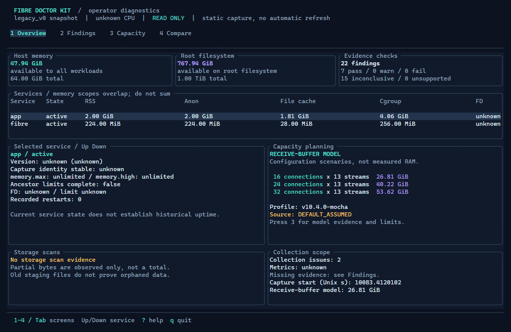

# Fibre Doctor Kit

Read-only diagnostics for Celestia Fibre operators. Open an interactive terminal interface, inspect findings and capacity, or compare two snapshots. HTML export is optional. Prebuilt binaries need no Rust, Python or Docker.

[Install](#installation) · [Open the terminal UI](#open-the-terminal-ui) · [Save a snapshot](#check-your-node) · [Compare snapshots](#compare-two-json-snapshots) · [Open HTML](#open-the-html-report)

## Installation

Download from [v0.2.1 Releases](https://github.com/ttt-labs/fibre-doctor-kit/releases/tag/v0.2.1):

| Download | SHA256 checksum | Use |
| --- | --- | --- |
| [Linux x86_64 binary](https://github.com/ttt-labs/fibre-doctor-kit/releases/download/v0.2.1/fibre-doctor-kit-linux-x86_64-musl) | [Checksum](https://github.com/ttt-labs/fibre-doctor-kit/releases/download/v0.2.1/fibre-doctor-kit-linux-x86_64-musl.sha256) | Collect, analyze and report |
| [Windows x86_64 executable](https://github.com/ttt-labs/fibre-doctor-kit/releases/download/v0.2.1/fibre-doctor-kit-windows-x86_64.exe) | [Checksum](https://github.com/ttt-labs/fibre-doctor-kit/releases/download/v0.2.1/fibre-doctor-kit-windows-x86_64.exe.sha256) | Analyze and report offline |
| [Complete release ZIP](https://github.com/ttt-labs/fibre-doctor-kit/releases/download/v0.2.1/fibre-doctor-kit-v0.2.1.zip) | [Checksum](https://github.com/ttt-labs/fibre-doctor-kit/releases/download/v0.2.1/fibre-doctor-kit-v0.2.1.zip.sha256) | Both binaries, docs and example report |

**On the Linux server**, run `uname -m` first. Use this download only if it returns `x86_64`; v0.2.1 has no ARM build. Run these commands in the directory where you want to keep the tool and snapshots:

```sh
release_url=https://github.com/ttt-labs/fibre-doctor-kit/releases/download/v0.2.1
curl -fL "$release_url/fibre-doctor-kit-linux-x86_64-musl" -o fibre-doctor-kit-linux-x86_64-musl &&
curl -fL "$release_url/fibre-doctor-kit-linux-x86_64-musl.sha256" -o fibre-doctor-kit-linux-x86_64-musl.sha256 &&
sha256sum -c fibre-doctor-kit-linux-x86_64-musl.sha256 &&
chmod +x ./fibre-doctor-kit-linux-x86_64-musl &&
./fibre-doctor-kit-linux-x86_64-musl --version
```

Checksum verification should say `OK`. Cloning the repo or downloading GitHub's **Source code** archives gives you source without binaries; see [building from source](docs/development.md#build-tests-and-packaging).

Upgrading from v0.2.0 or earlier? Starting with v0.2.1, binary filenames use `fibre-doctor-kit` instead of `doctor-fibre-kit`, matching the repository name. Download the new binary and use the commands below; existing snapshots still work. [Earlier releases](https://github.com/ttt-labs/fibre-doctor-kit/releases) remain available under their original filenames.

<details>
<summary>Windows installation (PowerShell, for offline analysis)</summary>

Run in a working directory on your PC:

```powershell
$ErrorActionPreference = 'Stop'
$releaseUrl = 'https://github.com/ttt-labs/fibre-doctor-kit/releases/download/v0.2.1'
Invoke-WebRequest "$releaseUrl/fibre-doctor-kit-windows-x86_64.exe" -OutFile .\fibre-doctor-kit-windows-x86_64.exe
Invoke-WebRequest "$releaseUrl/fibre-doctor-kit-windows-x86_64.exe.sha256" -OutFile .\fibre-doctor-kit-windows-x86_64.exe.sha256
$expectedChecksum = ((Get-Content -Raw .\fibre-doctor-kit-windows-x86_64.exe.sha256).Trim() -split '\s+')[0]
$actualChecksum = (Get-FileHash .\fibre-doctor-kit-windows-x86_64.exe -Algorithm SHA256).Hash
if ($actualChecksum -ne $expectedChecksum) { throw 'SHA256 mismatch; do not run this download.' }
.\fibre-doctor-kit-windows-x86_64.exe --version
```

Windows analyzes snapshots collected on Linux; it cannot collect live Linux node data. For the complete ZIP, verify its `.sha256` using the same checksum comparison with the ZIP filenames, then extract it. The bundle also contains an internal `SHA256SUMS` file.

</details>

## Open the terminal UI

**On the Linux server**, run this in an interactive terminal or SSH session:

```sh
./fibre-doctor-kit-linux-x86_64-musl tui
```

The tool collects once, then opens **Overview / Findings / Capacity / Compare**. Use **Tab** or **1–4** to switch views, **↑/↓** to navigate, **PgUp/PgDn** to scroll details, and **Q** or **Ctrl+C** to exit. Resize the terminal as needed; 100 columns or more is recommended.

The view shows a fixed capture, with no background polling. No snapshot or HTML is saved automatically. To keep data for later comparison, use the next section. For custom service names, homes or metrics, `tui` accepts the same collection options as `collect`.

To open an existing snapshot without collecting again:

```sh
./fibre-doctor-kit-linux-x86_64-musl tui --snapshot snapshot-before.json
```

On **Windows**, use `.\fibre-doctor-kit-windows-x86_64.exe tui --snapshot .\snapshot-before.json`. Live collection requires Linux. TUI needs an interactive terminal; plain text and JSON commands remain available for scripts and restricted collection keys.

## Check your node

**On the Linux server**, in the directory containing the binary:

```sh
./fibre-doctor-kit-linux-x86_64-musl collect --out snapshot-before.json &&
./fibre-doctor-kit-linux-x86_64-musl doctor --snapshot snapshot-before.json
```

This saves the first snapshot and prints findings in the terminal. `doctor` does not create HTML. Default services are `celestia-appd.service` and `fibre.service`; see [custom services, homes and metrics](docs/reference.md#collection-and-metrics) if yours differ.

Use an account with the required read permissions. Collection does not restart services, change configuration or inject traffic. Reads still use resources; review the first capture's collection issues and measured cost. `INCONCLUSIVE` means there is insufficient evidence for that check, not that the node has failed.

## Compare two JSON snapshots

**Already have two snapshots?** Skip the collection command below and substitute your filenames in the comparison command. Use JSON files produced by `collect`, with the **older file first** and the **newer file second**. `report.json` and `doctor --json` output are reports, not input snapshots.

If you only have the first snapshot, collect another later on the **same Linux server**, for example after a minute of normal operation:

```sh
./fibre-doctor-kit-linux-x86_64-musl collect --out snapshot-after.json
```

Then compare them directly in the terminal:

```sh
./fibre-doctor-kit-linux-x86_64-musl tui --snapshot snapshot-before.json --compare snapshot-after.json --mode temporal
```

Press **4** for the comparison. The other views show the newer snapshot. To optionally save an HTML report instead:

```sh
./fibre-doctor-kit-linux-x86_64-musl report compare snapshot-before.json snapshot-after.json --mode temporal --out report.html
```

The terminal should print `Created offline HTML report and public JSON sidecar.` You now have:

| File | Purpose |
| --- | --- |
| `snapshot-before.json`, `snapshot-after.json` | Private input snapshots; keep these for later analysis |
| `report.html` | Interactive report to open in a browser |
| `report.json` | Public comparison data for automation; not another snapshot |

Use `--mode temporal` for changes over time on the same host. For two different servers or independent environments, use `--mode ab` instead; this shows a side-by-side comparison without temporal counter rates. Missing identity, restarts or counter resets can make affected temporal calculations unavailable. See [comparison rules and legacy snapshots](docs/reference.md#capacity-and-comparison).

Output files are never overwritten. On another run, use new snapshot names and `--out report-02.html`; both `report-02.html` and `report-02.json` must be unused. If specifying an output folder, create it first.

**Prefer to compare on your Windows PC?** Copy both private snapshots into the same folder as the Windows executable, then run in PowerShell:

```powershell
.\fibre-doctor-kit-windows-x86_64.exe report compare .\snapshot-before.json .\snapshot-after.json --mode temporal --out .\report.html
```

## Open the HTML report

**If generated on your PC:** double-click `report.html`, or run `Start-Process .\report.html` in PowerShell. It works offline; no web server is needed.

**If generated on the server:** download just `report.html` through your existing SSH application's file browser, then open it on your PC. The HTML contains the report data; the JSON sidecar is optional for viewing.

Alternatively, run `pwd` on the server to find the report directory, then run the following in **PowerShell on your PC**. Replace `operator`, `server` and `/absolute/path/report.html` with your SSH username, host and the actual report path:

```powershell
scp operator@server:/absolute/path/report.html .\report.html
if ($LASTEXITCODE -eq 0) { Start-Process .\report.html }
```

Use your normal file-transfer access here; a key restricted to the collection command cannot run SCP/SFTP. Generating HTML over SSH does not automatically open a browser on your PC.

## Report preview



[Terminal comparison screenshot](docs/screenshots/tui-compare.png). These captures show the actual TUI running with the bundled **synthetic snapshots**; see [capture instructions](docs/development.md#terminal-ui-verification).


This preview uses **synthetic data**, not a live validator. [Full screenshot](docs/screenshots/report-full-en.png) · [Capacity detail](docs/screenshots/report-capacity-en.png) · [Example HTML](docs/examples/report.html) · [Example JSON](docs/examples/report.json). To view the example, download the HTML and open it locally; GitHub shows its source.

## More documentation

| Need | Guide |
| --- | --- |
| Capacity model, metrics, flags, finding statuses and collection limits | [CLI reference](docs/reference.md) |
| Restricted SSH collection and permissions | [Operations](docs/operations.md) |
| Data access, network behavior, privileges and security limits | [Security and privacy](SECURITY.md) |
| Snapshot fields and evidence sources | [Schema](docs/schema.md) |
| Build, test or reproduce the synthetic report | [Development](docs/development.md) |
| Completed checks and known validation limits | [Validation](docs/validation.md) |

Keep raw snapshots private. Generated reports omit selected operational identifiers; review them before sharing. There is no overall readiness score. The capacity model estimates receive buffers, not measured RAM or a hardware guarantee.

Contributions should include a reproducible case with synthetic or sanitized data. Do not submit operational snapshots, credentials or private keys. Licensed under [Apache-2.0](LICENSE).
