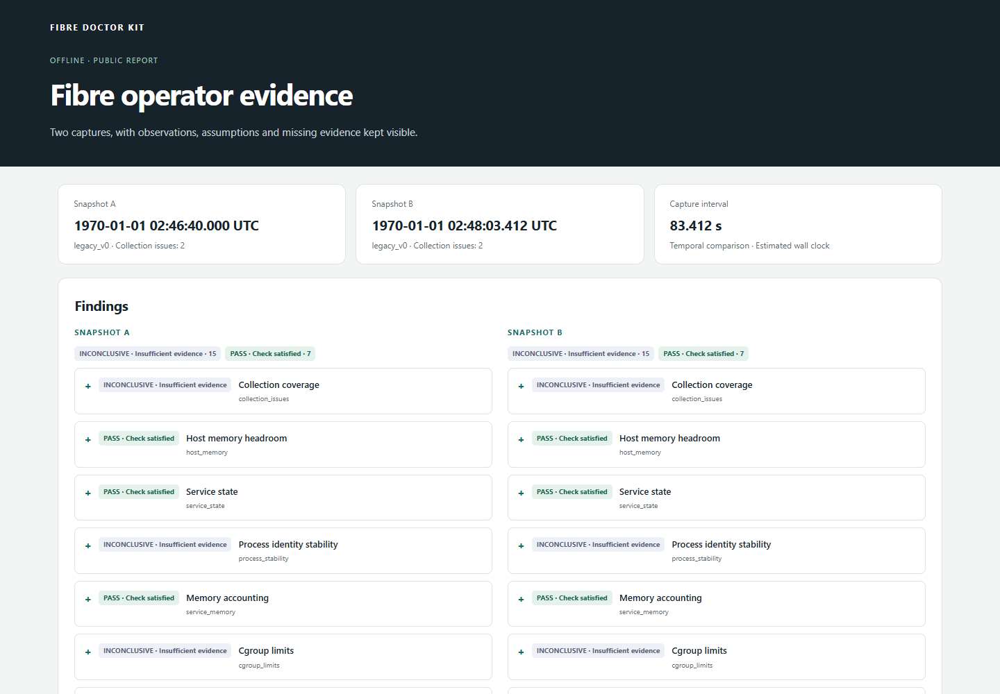
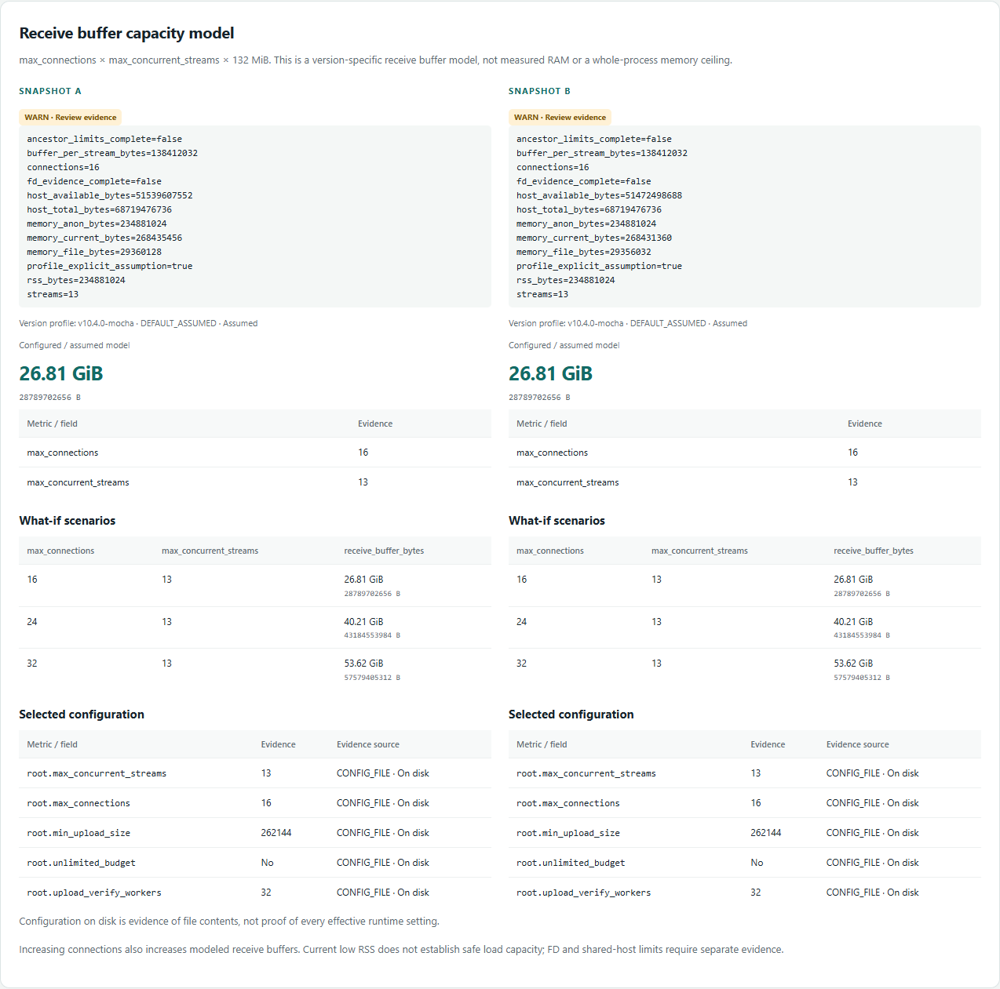

# Fibre Doctor Kit

Download a prebuilt executable from [v0.1.0 Releases](https://github.com/ttt-labs/fibre-doctor-kit/releases/tag/v0.1.0) and follow [Installation](#installation). Rust, Python and Docker are not required to run it.

| Download | SHA256 checksum | Use |
| --- | --- | --- |
| [Linux x86_64 static binary](https://github.com/ttt-labs/fibre-doctor-kit/releases/download/v0.1.0/doctor-fibre-kit-linux-x86_64-musl) | [Linux checksum](https://github.com/ttt-labs/fibre-doctor-kit/releases/download/v0.1.0/doctor-fibre-kit-linux-x86_64-musl.sha256) | Live collection and offline analysis |
| [Windows x86_64 executable](https://github.com/ttt-labs/fibre-doctor-kit/releases/download/v0.1.0/doctor-fibre-kit-windows-x86_64.exe) | [Windows checksum](https://github.com/ttt-labs/fibre-doctor-kit/releases/download/v0.1.0/doctor-fibre-kit-windows-x86_64.exe.sha256) | Offline analysis and reports |
| [Complete release ZIP](https://github.com/ttt-labs/fibre-doctor-kit/releases/download/v0.1.0/doctor-fibre-kit-v0.1.0.zip) | [ZIP checksum](https://github.com/ttt-labs/fibre-doctor-kit/releases/download/v0.1.0/doctor-fibre-kit-v0.1.0.zip.sha256) | Both executables, documentation and example report |

## Overview

Fibre Doctor Kit is a read-only CLI for Celestia Fibre operators. It collects bounded observations on a Linux host, analyzes snapshots offline, models receive-buffer capacity and compares captures in a standalone HTML report.

Version 0.1 has a terminal interface and an interactive **report viewer** in English. Expand findings in the HTML to inspect evidence and verification steps. The viewer cannot start collection, connect to SSH or change configuration. There is no desktop control panel or background dashboard.

| Capability | Windows x86_64 | Linux x86_64 |
| --- | --- | --- |
| Analyze snapshots; model capacity; generate HTML/JSON | Yes | Yes |
| Offline fixture collection with `--sysroot` | Yes | Yes |
| Live process, systemd, cgroup and storage collection | No | Yes |

Live collection targets systemd services and cgroup v2. Default services are `celestia-appd.service` and `fibre.service`. The initial Fibre capacity/storage profile is `v10.4.0-mocha`; unknown versions are not silently treated as supported. Unreadable sections remain missing or inconclusive.

The kit does not restart services, inject traffic, upload blobs, edit configuration or delete storage. Load benchmarks, recovery tests, automatic tuning and S3/R2 integration are outside v0.1.

## Report preview



This report was generated from the bundled [synthetic fixtures](tests/fixtures/legacy/), not measurements from a live validator.



The 16/24/32 connection values are receive-buffer model scenarios, not measured RAM consumption.

[Full report screenshot (English)](docs/screenshots/report-full-en.png) · [Capacity detail (English)](docs/screenshots/report-capacity-en.png) · [Offline HTML report](docs/examples/report.html) · [Public JSON report](docs/examples/report.json)

Download the HTML file and open it locally in your browser; GitHub displays its source rather than running the report viewer.

## Installation

Use the prebuilt files above for the quickest start. Cloning this repository or downloading GitHub's automatic **Source code (zip)** / **Source code (tar.gz)** archives gives you source code without executables. Those downloads require [building from source](#build-tests-and-packaging).

**Linux:** check the architecture first. Continue with the Linux download only if the output is `x86_64`; this release does not include an ARM executable.

```sh
uname -m
```

Download the binary and its checksum into a working directory, verify it, then run it. These commands require `curl` and `sha256sum`; no system-wide installation is required.

```sh
release_url=https://github.com/ttt-labs/fibre-doctor-kit/releases/download/v0.1.0
curl -fL "$release_url/doctor-fibre-kit-linux-x86_64-musl" -o doctor-fibre-kit-linux-x86_64-musl &&
curl -fL "$release_url/doctor-fibre-kit-linux-x86_64-musl.sha256" -o doctor-fibre-kit-linux-x86_64-musl.sha256 &&
sha256sum -c doctor-fibre-kit-linux-x86_64-musl.sha256 &&
chmod +x ./doctor-fibre-kit-linux-x86_64-musl &&
./doctor-fibre-kit-linux-x86_64-musl --version
```

If verification reports `OK`, collect a snapshot under an account that already has the required read permissions:

```sh
./doctor-fibre-kit-linux-x86_64-musl collect --out snapshot.json
```

The Linux artifact is a static binary. Live reads use systemd and `ss` where available; missing commands or permissions reduce collection coverage. Collection reads observations without restarting services or changing node configuration.

**Windows x86_64, PowerShell:** download the executable and verify its SHA256 before running it. Windows supports offline analysis; live collection runs on Linux.

```powershell
$ErrorActionPreference = 'Stop'
$releaseUrl = 'https://github.com/ttt-labs/fibre-doctor-kit/releases/download/v0.1.0'
Invoke-WebRequest "$releaseUrl/doctor-fibre-kit-windows-x86_64.exe" -OutFile .\doctor-fibre-kit-windows-x86_64.exe
Invoke-WebRequest "$releaseUrl/doctor-fibre-kit-windows-x86_64.exe.sha256" -OutFile .\doctor-fibre-kit-windows-x86_64.exe.sha256
$expectedChecksum = ((Get-Content -Raw .\doctor-fibre-kit-windows-x86_64.exe.sha256).Trim() -split '\s+')[0]
$actualChecksum = (Get-FileHash .\doctor-fibre-kit-windows-x86_64.exe -Algorithm SHA256).Hash
if ($actualChecksum -ne $expectedChecksum) { throw 'SHA256 mismatch; do not run this download.' }
.\doctor-fibre-kit-windows-x86_64.exe --version
```

For a snapshot copied from your Linux host:

```powershell
.\doctor-fibre-kit-windows-x86_64.exe doctor --snapshot .\snapshot.json
```

**Complete ZIP:** alternatively, download the release ZIP and its `.sha256` sidecar from the table. Verify the ZIP before extracting it, using `sha256sum -c doctor-fibre-kit-v0.1.0.zip.sha256` on Linux or the same `Get-FileHash` comparison on Windows with the ZIP filenames. The extracted bundle contains both executables, documentation, an offline example HTML report and an internal `SHA256SUMS` file. On Linux, `sha256sum -c SHA256SUMS` from the extracted directory verifies its contents. A separate [release SHA256SUMS](https://github.com/ttt-labs/fibre-doctor-kit/releases/download/v0.1.0/SHA256SUMS) lists the downloadable binaries and ZIP.

In subsequent examples, `doctor-fibre-kit` means the executable on your PATH. Otherwise substitute `./doctor-fibre-kit-linux-x86_64-musl`, `./target/release/doctor-fibre-kit`, or the corresponding Windows `.exe` path. Shell blocks marked `sh` use POSIX syntax; keep commands on one line when adapting them to PowerShell.

## Try it without a server

From the source checkout, generate a report from the bundled **synthetic** snapshots. These fixtures contain no validator data.

```sh
cargo run --locked -- doctor --snapshot tests/fixtures/legacy/snapshot-a.json
cargo run --locked -- capacity --snapshot tests/fixtures/legacy/snapshot-a.json --profile v10.4.0-mocha --target-connections 24
cargo run --locked -- report compare tests/fixtures/legacy/snapshot-a.json tests/fixtures/legacy/snapshot-b.json --mode temporal --allow-legacy-identity --profile v10.4.0-mocha --out example.html
```

Open `example.html` in a browser. `example.json` is the accompanying public report. No web server or internet connection is needed. Choose a new filename on subsequent runs: output files are not overwritten.

## CLI reference

| Command | Purpose |
| --- | --- |
| `collect --out snapshot.json` | Write one private operational snapshot; Linux live mode by default |
| `collect --stdout` | Emit the same snapshot to stdout; choose exactly one output destination |
| `doctor --snapshot snapshot.json` | Show findings, evidence, impact and verification steps |
| `doctor --snapshot - --json` | Read one snapshot from stdin and return public findings as JSON |
| `capacity --snapshot snapshot.json --target-connections 24` | Calculate a configuration scenario without applying it |
| `report compare A.json B.json --out report.html` | Write offline HTML and a public `report.json` sidecar |

The CLI and HTML report use English. JSON keys, metric names, flags and check IDs are stable identifiers. `doctor` and `capacity` support `--json`.

`--profile v10.4.0-mocha` is an explicit model assumption, not an observed binary version. Use it only when that assumption is justified. Results go to stdout and diagnostic messages to stderr. Exit code `0` means the command completed, **not** that every check passed; command/input errors return `2`. Automation should inspect finding statuses and collection issues.

## Collection and metrics

Override service names and homes when they differ from the defaults:

```sh
doctor-fibre-kit collect --out snapshot-custom.json --app-unit celestia-appd.service --fibre-unit fibre.service --app-home /srv/celestia --fibre-home /srv/fibre
doctor-fibre-kit collect --out snapshot-file.json --fibre-metrics-file metrics.prom
doctor-fibre-kit collect --out snapshot-http.json --fibre-metrics-url http://127.0.0.1:8889/metrics
doctor-fibre-kit collect --out snapshot-otel.json --otel-config /etc/otelcol/config.yaml
```

Paths and port `8889` above are examples, not discovered defaults. Supply your existing configuration. Explicit metrics URLs must use HTTP with a numeric loopback address and port; credentials, redirects and remote addresses are rejected. `--fibre-prom-url` is an alias for `--fibre-metrics-url`.

Metrics-file input takes precedence over URL/discovery and does not verify target identity or freshness. OTel discovery requires an identifiable local Fibre OTLP receiver, collector process/configuration and matching enabled Prometheus exporter pipeline. `--otel-config` helps validate that relationship; it does not turn any YAML file into a trusted endpoint. Ports are not guessed, and OTLP ingestion endpoints are not scraped as Prometheus endpoints.

`--no-fd-inspection` disables the additional inode-based matching between aged staging files and open descriptors; FD counts are still collected. `--sysroot PATH` instead selects offline fixtures and disables live commands/network. See [schema conventions](docs/schema.md) for field meanings.

## Capacity and comparison

For the supported profile:

```text
receive_buffer_bytes = max_connections × max_concurrent_streams × 132 MiB
```

With 13 concurrent streams, the model yields:

| Connections | Receive-buffer model |
| --- | --- |
| 16 | 26.8125 GiB |
| 24 | 40.21875 GiB |
| 32 | 53.625 GiB |

This is a concurrency model, not measured RAM, total process memory or a safe hardware recommendation. Increasing connections increases modeled buffers. RSS, anonymous memory, file cache and cgroup memory overlap; do not add them together. Account for other services, parent cgroup limits and FD headroom. `CONFIG_FILE` values are not proof that the running process loaded them; the other sources are `OBSERVED_RUNTIME`, `DEFAULT_ASSUMED` and `UNKNOWN`.

The default `--mode ab` compares independent environments side by side and never produces temporal counter rates. Use temporal mode for successive captures:

```sh
doctor-fibre-kit report compare before.json after.json --mode temporal --out temporal.html
doctor-fibre-kit report compare legacy-a.json legacy-b.json --mode temporal --allow-legacy-identity --out legacy.html
```

`Verified` requires complete process/host/boot identity evidence. `HeuristicLegacy` is an explicit same-host assumption for older snapshots, not verified continuity. `Mismatch` and `Unknown` withhold affected temporal calculations. Rates also require valid timing and appropriate process/cgroup/host scope; counter resets make rates unavailable. A short memory delta does not establish a leak or historical uptime.

## Reading findings and collection limits

| Status | Meaning |
| --- | --- |
| `PASS` | The individual check is satisfied by the available evidence |
| `WARN` | An observation needs investigation |
| `FAIL` | Evidence violates that check's condition |
| `INCONCLUSIVE` | Evidence is missing, incomplete, stale or insufficient |
| `UNSUPPORTED` | The version or observation cannot be evaluated by the supported model |

There is no overall readiness score. A collection error is not automatically a node failure. Signing requires the appropriate version, scoped samples and verified activity freshness; warm-up or a recent HTTP scrape alone does not establish healthy signing. Live v0.1 collection conservatively leaves freshness unverified.

| Collection bound | Limit |
| --- | --- |
| Overall collection work budget | 20 seconds, plus bounded cleanup/serialization overhead |
| Flat scan per `staging/` or `shards/` | 2 seconds / 50,000 entries |
| Kill/reap polling grace | 100 ms, nonblocking |
| Config read / metrics response / snapshot | 64 KiB / 1 MiB / 8 MiB |
| Aged staging threshold | More than 900 seconds |

Scans do not follow symlinks and deduplicate hardlinks. A partial result is **bytes observed**, not an instantaneous total or reliable lower bound during concurrent writes/pruning. `has_open_fd` is true, false or unknown; false requires complete scoped inspection and stable identity. Neither age nor a closed FD proves that a file is an orphan or safe to delete. A kernel-blocked worker can outlive a kill request; `cleanup_pending` exposes this.

Collector costs separate parent, collection worker and scanner CPU/RSS. Do not sum peak RSS values into a process-tree peak. Measurements end before final JSON serialization and SSH transfer. Reads still consume resources; review a first capture before repeated use.

## Privacy and SSH operation

Keep raw snapshots private. Public reports use an allowlisted projection that omits host/boot hashes, operational paths, PIDs, raw errors and arbitrary metric labels. This reduces disclosure but is not a blanket anonymity guarantee; review reports before publishing. Large integer measurements are decimal strings in public JSON to preserve browser precision.

Install through an administrative channel, then use a dedicated restricted collection key. An `authorized_keys` **template** is:

```text
restrict,expiry-time="YYYYMMDDHHMMSSZ",command="/usr/local/bin/doctor-fibre-kit collect --stdout" ssh-ed25519 PUBLIC_KEY collector-only
```

Replace the date and public key, verify the host fingerprint, and protect binary ownership. The client command below assumes that the forced command is already configured; the word `snapshot` is not a remote subcommand installed by the kit.

```sh
ssh -n -T -o BatchMode=yes -o StrictHostKeyChecking=yes -o IdentitiesOnly=yes -o ForwardAgent=no -o ClearAllForwardings=yes -i /path/to/dedicated_key operator@host snapshot | doctor-fibre-kit doctor --snapshot -
```

No private key is required in the repository. See [operations](docs/operations.md) for account permissions and fixed-command deployment.

## Build, tests and packaging

The manifest declares Rust 1.85; recorded builds used Rust 1.99.0. Use `Cargo.lock`. Windows MSVC builds require the C++ build tools and Windows SDK; Windows GNU builds need compatible MinGW tools. Building a static Linux target also needs that Rust target and a compatible linker.

```sh
cargo fmt --all -- --check
cargo test --locked
cargo clippy --locked --all-targets -- -D warnings
cargo build --locked --release
rustup target add x86_64-unknown-linux-musl
cargo build --locked --release --target x86_64-unknown-linux-musl
cp target/x86_64-unknown-linux-musl/release/doctor-fibre-kit ./doctor-fibre-kit-linux-x86_64-musl
./doctor-fibre-kit-linux-x86_64-musl --version
```

Cargo names the Linux executable `doctor-fibre-kit`; packaging gives it the filename `doctor-fibre-kit-linux-x86_64-musl` used in the installation examples. The `cp` command above creates that filename in your checkout. Run these Linux build commands on a development or lab machine, then copy the finished binary to the validator. Windows users can use the cross-compilation helper below and run the resulting Linux binary on Linux.

Windows helpers support native builds and musl cross-compilation without WSL:

```powershell
powershell -NoProfile -ExecutionPolicy Bypass -File scripts/build-windows.ps1 -Release
powershell -NoProfile -ExecutionPolicy Bypass -File scripts/build-linux-from-windows.ps1 -Tests
powershell -NoProfile -ExecutionPolicy Bypass -File scripts/package.ps1
powershell -NoProfile -ExecutionPolicy Bypass -File scripts/package-source.ps1
```

The Linux helper compiles test executables; run them in a Linux lab to validate runtime behavior. Binary packaging requires both release targets and an unused output directory. Source packaging excludes local snapshots, SSH artifacts, build outputs and Git history. The build helpers do not install a missing Rust toolchain or compiler automatically.

Synthetic legacy fixtures are committed under `tests/fixtures/legacy/`. `--sysroot` fixtures use mirrored Linux files plus `run/ttt-fibre/<unit>.show`, `clock.json`, `staging.scan.json` and `shards.scan.json`. The `run/ttt-fibre/` fixture directory is retained for compatibility; no live Unix metadata is inferred on Windows. `tests/linux_lab.py` is for a **disposable Alpine VM only**, never an operational node. `scripts/verify-report.py` uses Playwright to verify offline report interactions; Python is a development dependency only.

See the [validation record](docs/validation.md) for actual test counts and limitations. Lab checks do not establish production-validator compatibility. The supplied GitHub Actions workflow runs formatting, tests and lint/build checks when enabled in a repository; a workflow file is not evidence of a completed hosted run.

## Troubleshooting and project layout

| Symptom | Action |
| --- | --- |
| Live collection fails on Windows | Analyze a Linux snapshot or use explicit `--sysroot` fixtures |
| Output already exists | Choose a new filename; reports also reserve the `.json` sidecar |
| Unknown version / unavailable capacity | Verify the binary version and config; only explicitly assume the supported profile when justified |
| Empty metrics / inconclusive signing | Check the configured exporter, ownership, sample scope and freshness; do not guess ports |
| Partial scan / `cleanup_pending` | Inspect the stop reason and host I/O condition before retrying; do not delete data |
| Invalid stdin / expired probe output | Provide one supported JSON snapshot; an SSH or probe error is not a snapshot |

| Path | Contents |
| --- | --- |
| `src/model.rs`, `src/parser.rs` | Snapshot types and legacy conversion |
| `src/analyzer.rs` | Doctor, capacity and comparison logic |
| `src/collector/` | Bounded Linux collection and fixture readers |
| `src/report.rs`, `assets/` | Public projection and offline English report |
| `tests/`, `scripts/` | Regression fixtures, lab/UI verification and packaging |
| `docs/` | Operations, schema and validation notes |

Contributions should include a reproducible case with synthetic or sanitized data and relevant tests. Do not submit raw operational snapshots, credentials or private keys. Licensed under [Apache-2.0](LICENSE).
